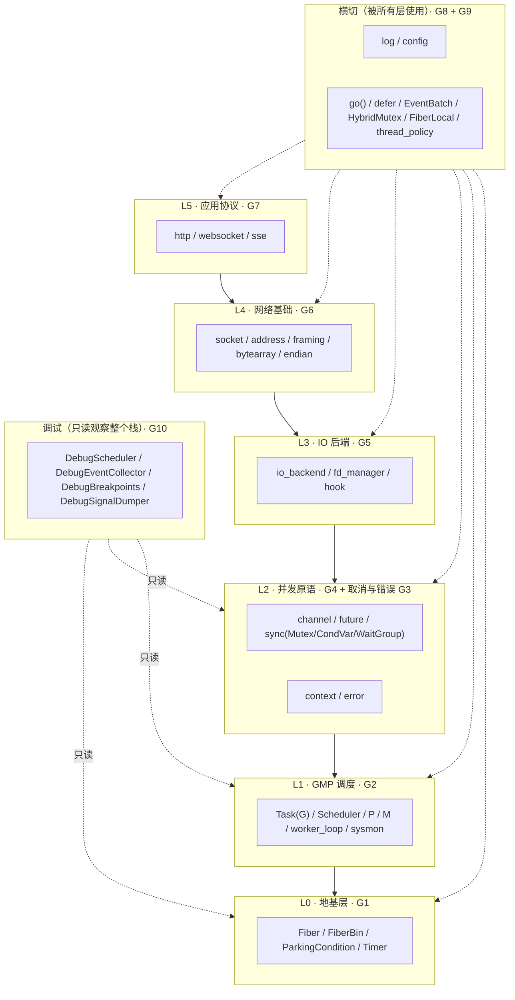
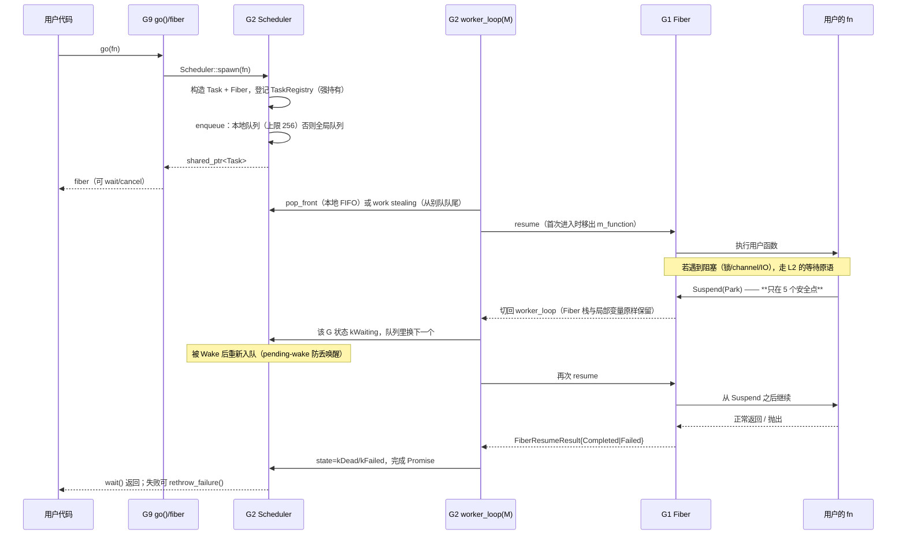
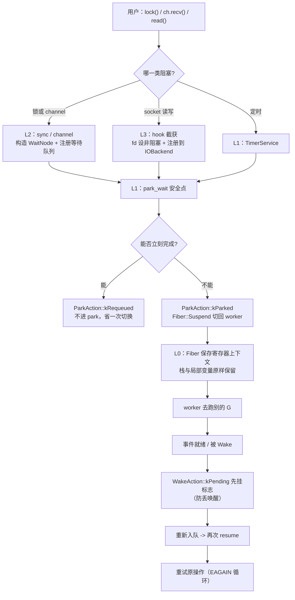
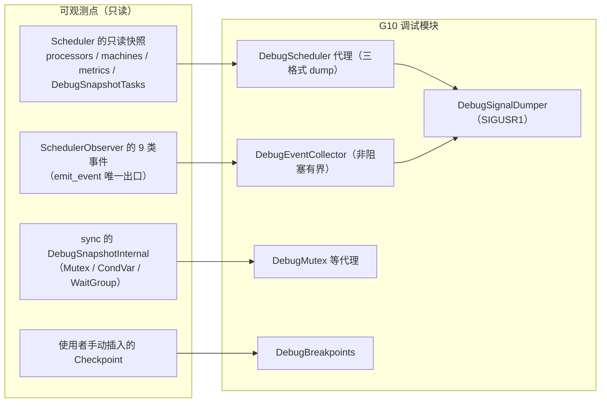

# G0 · 总览：10 组模块如何拼成一次 `go()` —— 一图看懂

> 这是「先看整体」的那一张。想看细节请进入对应组的图：G1~G10。
> 本图不复述任何组内部细节，只画**层次、依赖方向**，以及**一次协程生命周期穿过哪些层**。

## ① 分层与依赖方向（谁可以依赖谁）

**依赖规则**：箭头**只允许向下**（L5→L4→…→L0）。`LX` 与 `LD` 是横向的：
前者可被任意层使用，后者**只读**地观察、绝不反向控制。

## ② 一次 `go(fn)` 到完成，穿过了哪些层

## ③ 阻塞一次，会跨过哪几层

## ④ 调试模块如何只读地观察这一切

**方向性很重要**：`G10` 只有**指向框架的读箭头**，**没有**任何从框架指向 `G10` 的调用
（唯一的例外是 `SchedulerObserver::OnEvent`，那是框架本来就有的**只读**插件边界）。
因此**删掉整个 `debug` 模块，框架行为不变**。

## ⑤ 与 Go 的层次对照

| Go 的层次 | Go2Cpp 的对应 | 差异要点 |
|---|---|---|
| `runtime`（GMP + 抢占 + 栈增长） | **G1 + G2** | 纯协作、**固定栈**、无抢占 |
| `runtime` 的 netpoll | **G5**（可替换 `IOBackend`） | 需线程显式参与 hook |
| `sync` / `chan` | **G4** | 无自旋；受管 G 有**有界协作重试** |
| `context` / `errors` | **G3** | 具体类而非接口；`WrappedError` 可解包 |
| `net` / `net/http` / 第三方 ws | **G6 + G7** | ws 与 SSE **内置** |
| 标准库 log / 第三方 config | **G8** | 三抽象 + 类型安全 `ConfigVar<T>` |
| 无（Go 无 `defer` 之外的语法糖层） | **G9** | `go()`/`defer`/`EventBatch` 让 Go 代码近乎原样编译 |
| `runtime/trace` + `pprof` + `dlv` | **G10** | 覆盖更窄：**只读 + 协作式**，但可跨进程信号 dump |

## 怎么用这套图

1. **先看本图**（G0）建立层次与方向感；
2. **遇到具体问题再进对应的组**：卡死 → G2/G4；IO 慢 → G5/G6；协议问题 → G7；
   要排障 → G10；
3. 每组图内固定四段：类架构 → 重要函数实现 → 向上层提供什么 → 状态流转；
4. 每张图末尾都有「与 Go 的差异」表 —— **这个项目最容易出错的地方就是按 Go 语义误用**。
