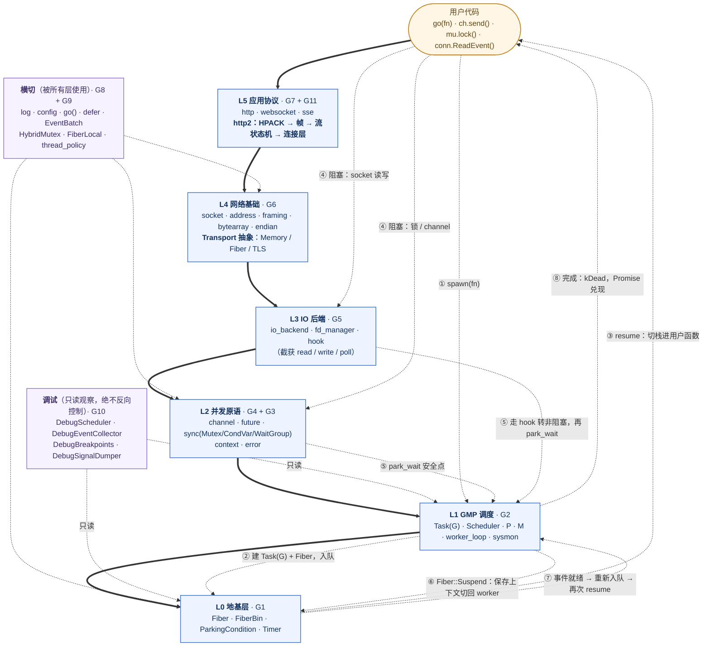

# G0 · 总览：一张图看懂整个框架 —— 分层 · 依赖方向 · 一次 `go()` 的穿越路径

> **本文件只有 1 张 Mermaid 图**。这是刻意的：G0 的职责是让读者**在一屏之内**
> 建立「有哪些层、谁能依赖谁、一次协程怎么穿过它们」的整体感。
> 时序、状态机、阻塞细节都在 G1~G11 的下钻图里，**本图不复述**。
>
> 关键设计：**依赖方向（结构）与执行方向（过程）同向** —— 都是「上层 → 下层」。
> 所以它们能共用同一张图：**实线是编译期依赖，带编号的虚线是一次运行的生命周期**。

## 一、主图

**读法（三遍）**：

1. **先看实线** —— 这是**编译期依赖**。箭头只允许向下：`L5 → L4 → … → L0`，
   **没有任何一条实线向上**。任何实现里出现下层 `#include` 上层，就是分层被破坏。
2. **再看两条旁路** —— `LX`（横切，可被任意层使用）与 `LD`（调试，**只读箭头**）。
   `LD` 没有任何指向框架的控制箭头，所以**删掉整个 `debug` 模块，框架行为不变**。
3. **最后看带编号的虚线** —— 这是一次 `go(fn)` 的**生命周期**：从 spawn 到完成，
   它**往返穿越了 8 次**层次边界。注意 ④→⑤→⑥ 那段：阻塞会一路下沉到 L1 的
   `park_wait` 安全点，再经 L0 的 `Fiber::Suspend` 切回 worker。

## 二、分层规则（这张图真正的约束）

| 规则 | 内容 | 违反后的症状 |
|---|---|---|
**只向下依赖** | `L(n)` 可以依赖 `L(n-1)` 及更低，**不能**依赖更高层 | 循环依赖、无法单独测试某层 |
**横切不反向** | `LX` 可被任意层调用，但它**不持有**上层对象 | 日志/配置里出现协议类型 → 依赖倒置 |
**调试只读** | `LD` 只通过 `SchedulerObserver` 等**既有**的只读边界观察 | 若框架回调 debug 模块，则 debug 不可整体删除 |
**`Transport` 是 IO 的唯一出口** | HTTP/2 等协议只认 `Transport` 三个方法，不碰 `Socket` | 协议逻辑无法脱离网络测试（本项目的 HTTP/2 正是靠这条在内存缓冲上测完的） |

## 三、下钻索引：想看什么 → 去哪张图

| 你想搞清楚 | 去哪 | 那张图回答什么问题 |
|---|---|---|
| **GMP 调度**：P/M 怎么协作、work stealing、sysmon | **G2** | 一个 G 从入队到执行到完成，队列与状态怎么变 |
| **Fiber 切换**：栈怎么切、`ParkingCondition` 怎么等 | **G1** | `Suspend`/`Resume` 在寄存器与栈上发生了什么 |
| **阻塞语义**：锁、channel、IO、定时四类怎么 park | **G4 / G5** | 谁构造 WaitNode、谁决定 `kRequeued` vs `kParked` |
| **网络基础**：Socket/Address/Framer | **G6** | 一次 `accept`/`read` 的数据结构路径 |
| **HTTP/1.1 / WebSocket / SSE** | **G7** | 报文如何分帧解析、连接如何升级 |
| **HTTP/2 全栈**：HPACK、帧层、流状态机、连接层、Transport | **G11** | 四层如何拆、为什么能脱离网络测试、已实现 vs 只设计 |
| **取消与错误** | **G3** | Context 树如何传播取消、错误如何包装 |
| **log / config** | **G8** | ConfigVar 的类型安全与热更新、日志三抽象 |
| **语法糖层**：`go()` / `defer` / `select` | **G9** | Go 代码如何近乎原样编译 |
| **排障**：dump、断点、SIGUSR1 | **G10** | 只读观察点有哪些、三格式 dump 怎么生成 |

## 四、与 Go 的层次对照

| Go 的层次 | 本项目对应 | 关键差异 |
|---|---|---|
| `runtime`（GMP + 抢占 + 栈增长） | **G1 + G2** | 纯协作、**固定栈**、无抢占 |
| `runtime` 的 netpoll | **G5**（可替换 `IOBackend`） | 需线程显式参与 hook |
| `sync` / `chan` | **G4** | 无自旋；受管 G 有有界协作重试 |
| `context` / `errors` | **G3** | 具体类而非接口；`WrappedError` 可解包 |
| `net` / `net/http` / 第三方 ws | **G6 + G7 + G11** | ws 与 SSE **内置**；**HTTP/2 自研全栈** |
| 标准库 log / 第三方 config | **G8** | 三抽象 + 类型安全 `ConfigVar<T>` |
| 无（Go 只有 `defer`） | **G9** | `go()`/`defer`/`EventBatch` 让 Go 代码近乎原样编译 |
| `runtime/trace` + `pprof` + `dlv` | **G10** | 覆盖更窄：**只读 + 协作式**，但可跨进程信号 dump |

## 五、这套图的组织约定

1. **G0 一张图**（本文件）+ **G1~G11 各一张下钻图**，每张下钻图固定四段：
   ① 类架构 → ② 重要函数实现 → ③ 向上层提供什么 → ④ 状态流转；
2. 每个模块文件末尾都有**与 Go 的差异**表 —— 这个项目最容易出错的地方就是按 Go 语义误用；
3. 状态机必须写清**触发条件**（谁在什么情况下推动转移），不能只画箭头；
4. **已实现 vs 只设计**必须分开写（G11 §⑤ 是范例：HTTP/2 已实现，QUIC 只有选型文档）。
