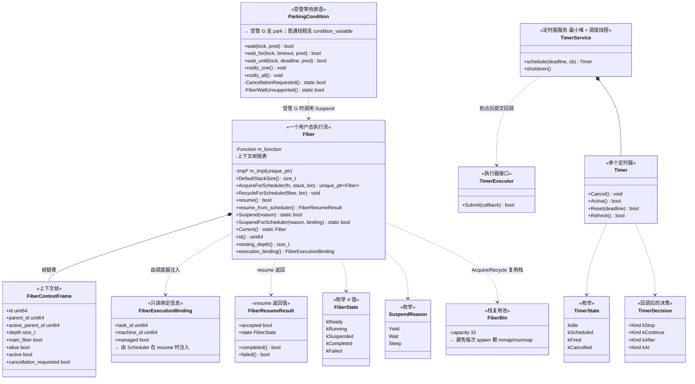
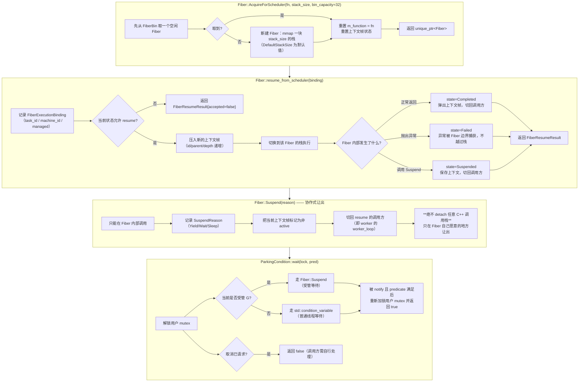
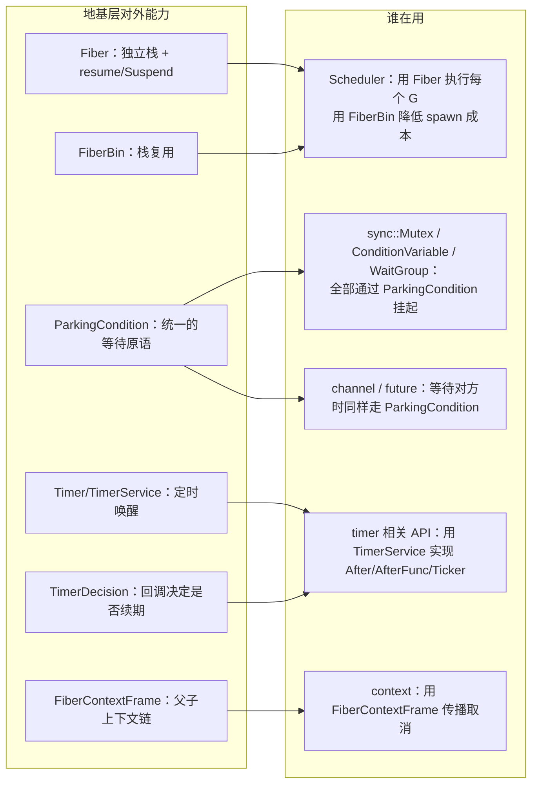
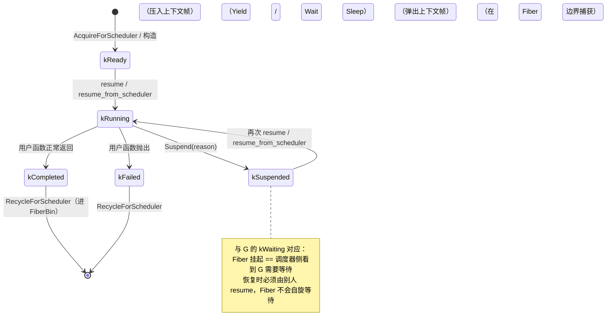
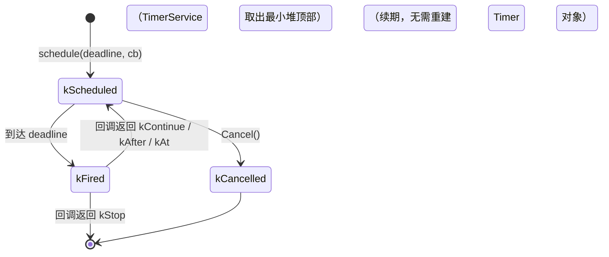

# G1 · 地基层 —— 一图看懂

> 覆盖：`Fiber`（用户态栈与协作式切换）、`FiberContextFrame`、`FiberExecutionBinding`、
> `ParkingCondition`（受管等待原语）、`Timer` / `TimerService` / `TimerDecision`（定时器）。
> 源码：`include/go2cpp/concurrency/fiber.hpp`、`core/parking_condition.hpp`、`core/timer.hpp`
> 与对应 `.cpp`。

**这一层是整个运行时的地基**：它不知道"调度器"的存在，只提供「切换执行流」与「未来某个时刻唤醒我」两件事。

## ① 类架构：每个类用的底层能力 + 主要职责



**职责一句话总结**

| 类 | 主要职责 | 用到的底层能力 |
|---|---|---|
| `Fiber` | 一块**固定大小的用户态栈** + `resume`/`Suspend` 协作式切换；记录上下文帧链路 | `mmap`/`munmap`（栈）、`ucontext` 或等价的手写切换 |
| `FiberBin` | **栈复用池**（默认 32 个），避免每次 `spawn` 都系统调用 | `Fiber` 回收 |
| `FiberContextFrame` | 记录「谁在谁里面」（父子、深度、是否 main、是否被取消） | 无（纯数据） |
| `FiberExecutionBinding` | 记录「这个 Fiber 当前属于哪个 G / 哪个 M / 是否受管」 | 无（纯数据） |
| `ParkingCondition` | 让**受管 G** 用 park 等待、让**普通线程**用 `condition_variable` 等待，**同一套 API** | `Fiber::Suspend` 或 `std::condition_variable` |
| `Timer` / `TimerService` | 「未来某时刻唤醒我」；`TimerDecision` 让回调决定停止/继续/改期 | `std::thread` + 最小堆 + 条件变量 |
| `TimerExecutor` | 把「到点的回调」**交给谁执行**（通常提交给调度器） | 抽象接口 |

## ② 重要函数：功能与实现要点



**要点（源码约束）**

- `Fiber` 的栈**固定大小**，**不可增长**（与 Go 的可增长栈是本质差异，深递归会失败）；
- `AcquireForScheduler` / `RecycleForScheduler` 成对出现，配合 **`FiberBin`（默认 32）** 复用栈，避免频繁 `mmap`；
- `resume_from_scheduler` 是**调度器视角**的入口（带 `binding`），`resume()` 是无绑定的通用入口；
- 返回 `FiberResumeResult` 而非 `bool`，因为调用方需要知道**是完成、失败还是挂起**；
- `Suspend` 是**静态**方法且**只能在 Fiber 内调用**，意味着「让出」必须由 G 自己发起 —— 这就是"纯协作式"的技术根源；
- `ParkingCondition` 把**受管 G** 与**普通线程**两种等待统一到一个 API：前者 park、后者 `condition_variable`；
- `TimerDecision` 让定时器回调返回 `kStop`/`kContinue`/`kAfter`/`kAt` —— 决定"是否继续、下次何时"，因此**周期定时器不需要反复重建**。

## ③ 向上层提供了什么



## ④ 状态流转

### Fiber 的状态机（对应 G 在调度器中的可见状态）



### Timer 的状态机



## 附：一次「挂起 → 被唤醒」的栈变化（ASCII）

```
worker 线程栈                         Fiber 栈
     |                                   |
     |-- resume_from_scheduler --------->|
     |                                   |-- 用户代码
     |                                   |   (遇到锁 / channel)
     |                                   |-- ParkingCondition::wait
     |                                   |-- Fiber::Suspend(Wait)
     |<-- 切回（保存 Fiber 的寄存器上下文）|
     |                                   |
     |   (worker 去执行别的 G)            |  (Fiber 栈保持原状，不销毁)
     |                                   |
     |-- 被唤醒，再次 resume ----------->|
     |                                   |-- 从 Suspend 之后继续
     |                                   |-- 返回用户代码
     |<-- 栈上数据全部保留 ---------------|
```

> **关键点**：`Fiber::Suspend` 只是**保存寄存器并切回调用方**，Fiber 的栈与局部变量**原样保留** ——
> 这正是"协程比线程便宜"的原因，也是为什么**必须在 Fiber 内主动让出**（不能从外部 detach 栈）。

## 与 Go 的差异

| 项 | Go | Go2Cpp |
|---|---|---|
| 栈 | 可增长（copy 栈，2KB 起） | **固定大小**，`fiber_stack_size` 决定，不可增长 |
| 切换 | 运行时抢占点 + `gopark` | **纯协作**，只有 `Suspend` 能切，且必须在 Fiber 内调用 |
| 上下文 | `goexit` 栈 + defer 链 | `FiberContextFrame` 链表（父子/深度/取消标志） |
| 定时器 | 四叉堆 + `netpoll` 合流 | 最小堆 + 独立调度线程，到点通过 `TimerExecutor` 提交 |
| 等待原语 | `sudog` 队列 | `ParkingCondition`（受管走 park、普通线程走 `condition_variable`） |
