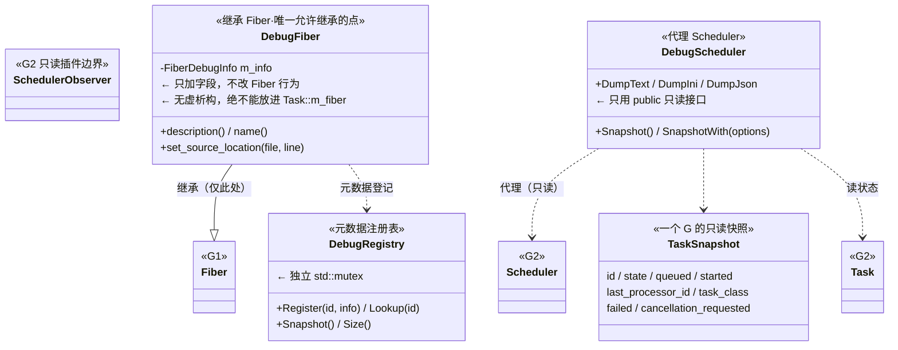
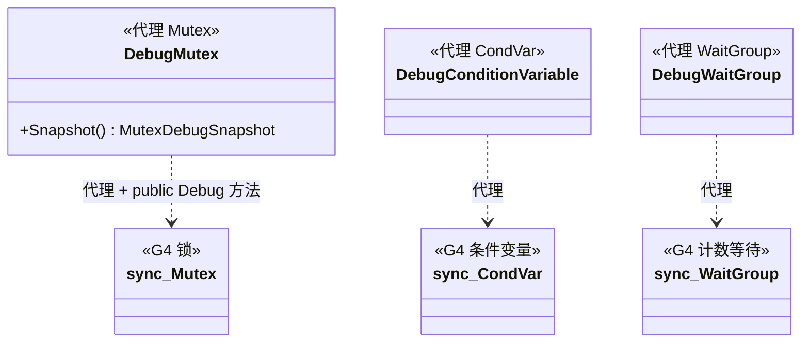
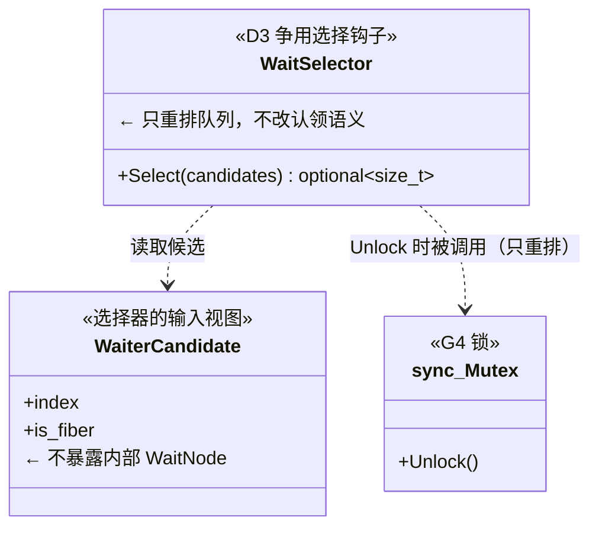
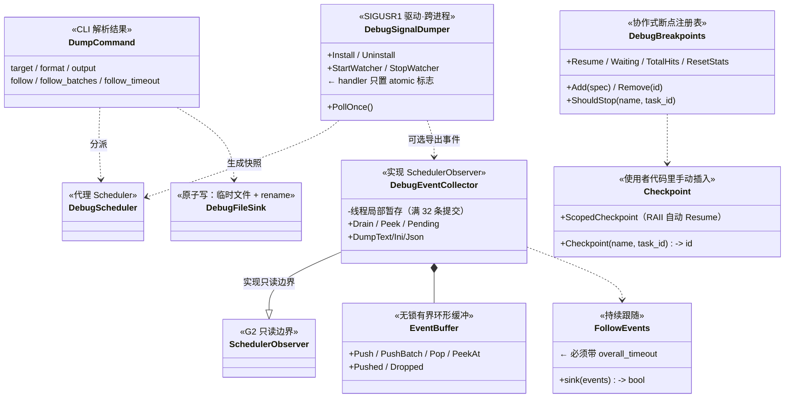
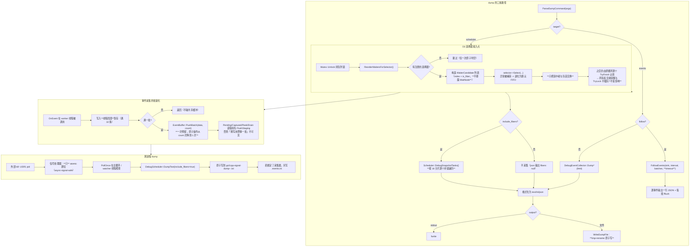
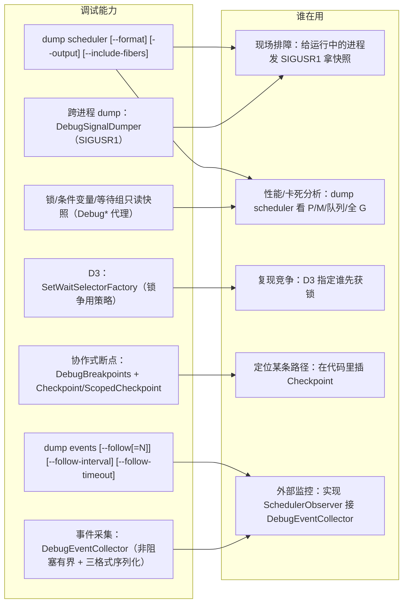
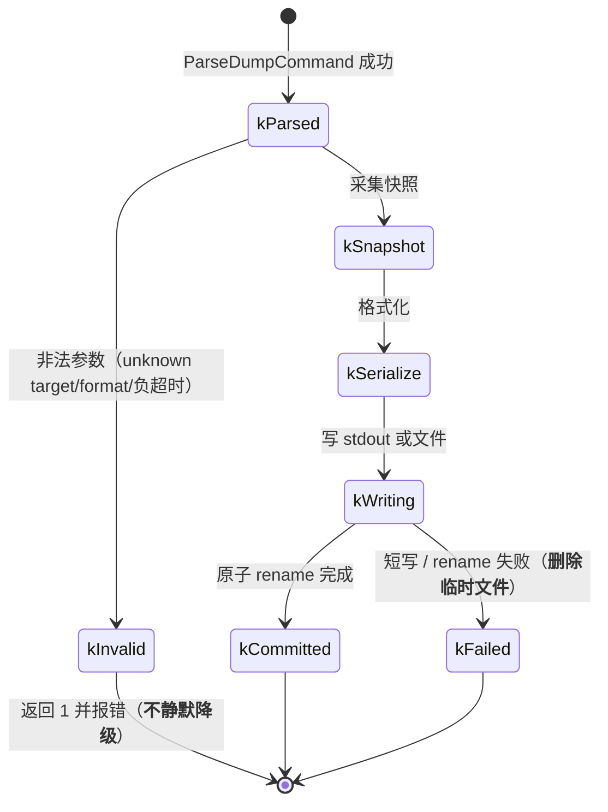
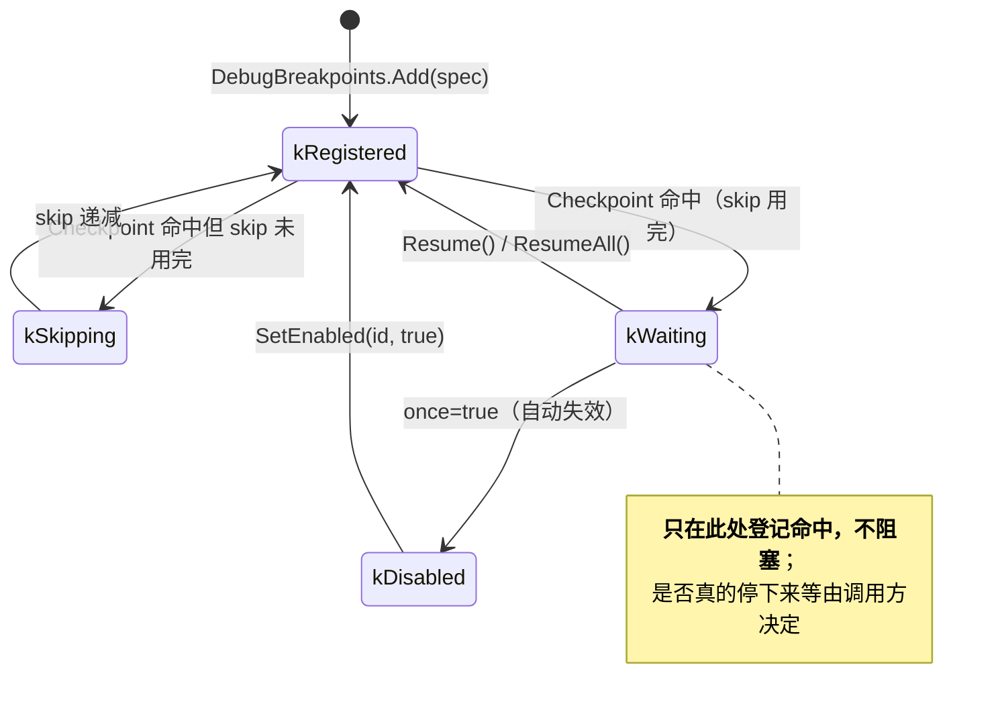
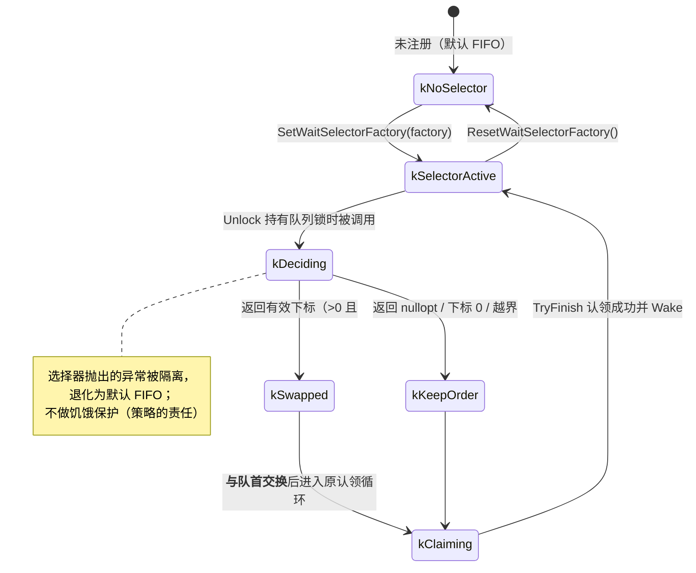

# G10 · 调试模块（go2cpp::debug）—— 一图看懂

> 覆盖本次新增的调试模块：`DebugFiber`/`DebugRegistry`、`DebugScheduler`/`DebugTask` 视图、
> `dump CLI`（含 `--follow`）、`DebugMutex`/`DebugConditionVariable`/`DebugWaitGroup`、
> `EventBuffer`/`DebugEventCollector`、`DebugBreakpoints`/`Checkpoint`、
> `DebugSignalDumper`（跨进程 dump）。另含 `sync::WaitSelector`（D3 锁争用选择钩子）。
> 源码：`include/go2cpp/debug/*.hpp`（7 个头文件）、`tests/debug/*.cpp`（7 个测试）、
> `benchmarks/debug_*_benchmark.cpp`（2 个基准）、`example/debug/debug_module_demo.cpp`（示例）。

**设计主线**：**能继承的继承，不能继承的用代理** —— 并且**绝不在调度器热路径上加钩子**。

## ① 类架构：每个类用的底层能力 + 主要职责

> 本模块共 19 个类型，一次性画在一张图上会被 Mermaid 横向铺开、文字小到不可读。
> 因此按职责拆成 **3 张**（每张 7~8 类，一屏可读）。

### ①-A 核心链路（原 Fiber/Task/Scheduler → 调试侧）

### ①-B 锁观测代理（原 sync → 调试侧）

### ①-B′ D3：锁争用选择钩子

### ①-C 事件采集 / CLI / 断点 / 信号 dump

## ② 重要函数：功能与实现要点

**要点（含设计上的硬约束）**

- **`DebugFiber` 是唯一用继承的地方**，因为它是"用户自己创建并真实执行"的对象；其余全是**代理**，因为它们包装的是**框架已创建的对象**；
- **`DebugFiber` 绝不能放进 `Task::m_fiber`**：`Fiber` **没有虚析构**（实测 `is_polymorphic == 0`），通过 `unique_ptr<Fiber>` 销毁 `DebugFiber` 是 UB；
- **D3 只重排队列顺序**，不改"逐个 `TryFinish` 认领"的裁决方式，所以"所有权无缝转移、`TryLock` 不能插队"完全不受影响；
- **`FollowEvents` 必须带总超时**：否则缓冲一直为空时 `batches` 永远到不了上限 → 无限循环（**首版就踩了这个坑，导致整条 ctest 超时**）；
- **信号处理器只置原子标志**，绝不做 I/O/分配/加锁（那不是 async-signal-safe）；
- **`include_fibers` 默认关闭**：枚举全部 G 要遍历 16 个分片，成本高于其它快照，所以按需开启。

## ③ 向上层提供了什么

## ④ 状态流转

### 一次 dump 请求的生命周期

### 协作式断点的命中与恢复

### 锁争用选择器（D3）的决策流

## 与 Go 的差异

| 项 | Go | Go2Cpp |
|---|---|---|
| 观测接口 | `runtime/trace` + `pprof`（丰富） | `SchedulerObserver` 的 9 类**只读**事件 + dump 快照 |
| 控制能力 | 可用 `trace`/`debug` 包间接影响 | **只开放观测类与节律类**，结构类明确拒绝（P4 控制面不做）|
| 断点 | 用 `dlv` 任意行、任意变量 | **协作式**：只能在 `Checkpoint` 处停；**不强制 detach 任意 C++ 调用栈** |
| 跨进程 dump | `SIGQUIT` 打印全部 goroutine 栈 | `SIGUSR1` 写快照到文件（含全 G 列表与可选事件流）|
| 锁持有者 | `mutex` profile 有争用信息 | **无 owner 字段**（`m_state` 不记录持有者，Go 风格所有权允许 A 锁 B 解）|
| 时间基准 | `nanotime`（单调） | **双时间戳**（steady + wall），明确声明**不做跨机绝对对齐** |
