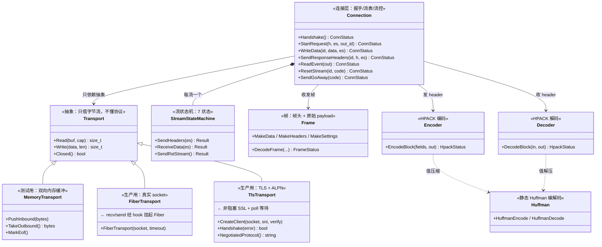
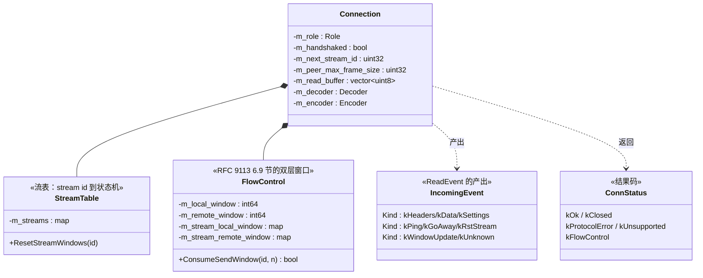
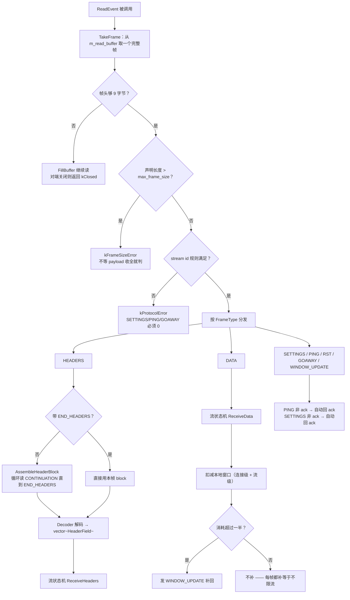
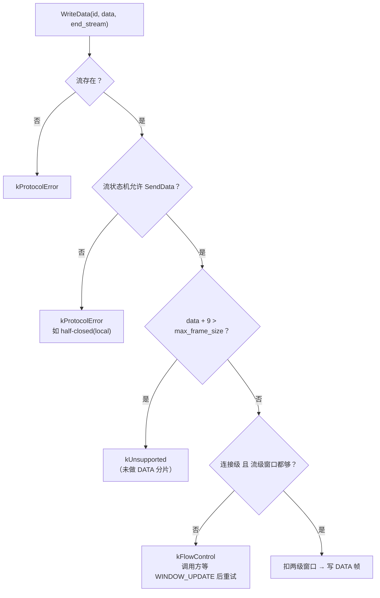
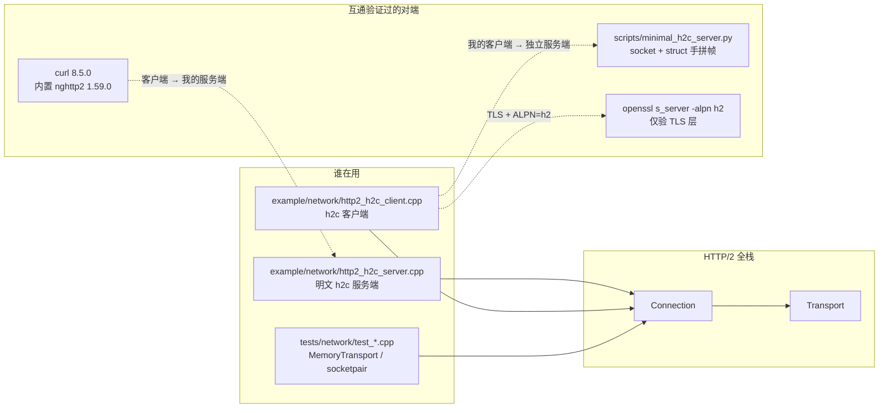
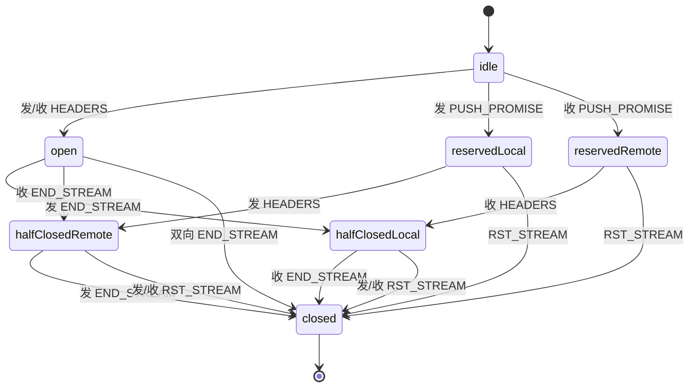
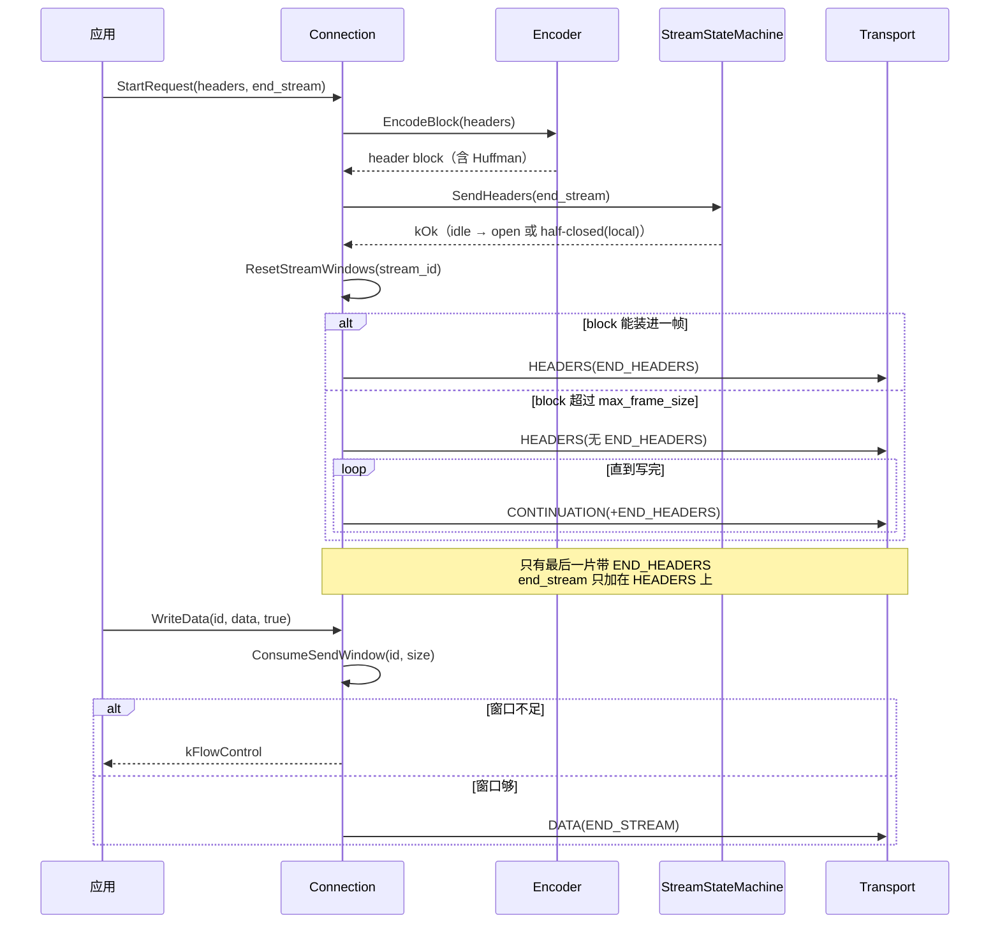
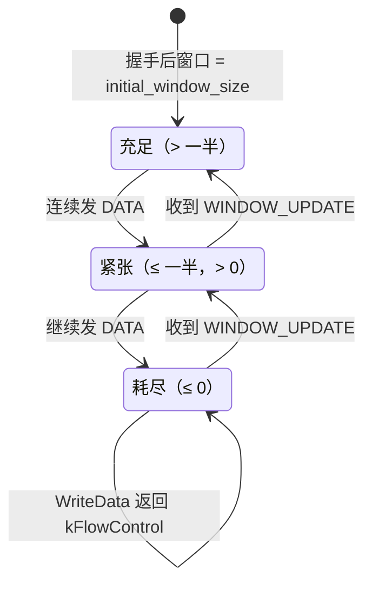
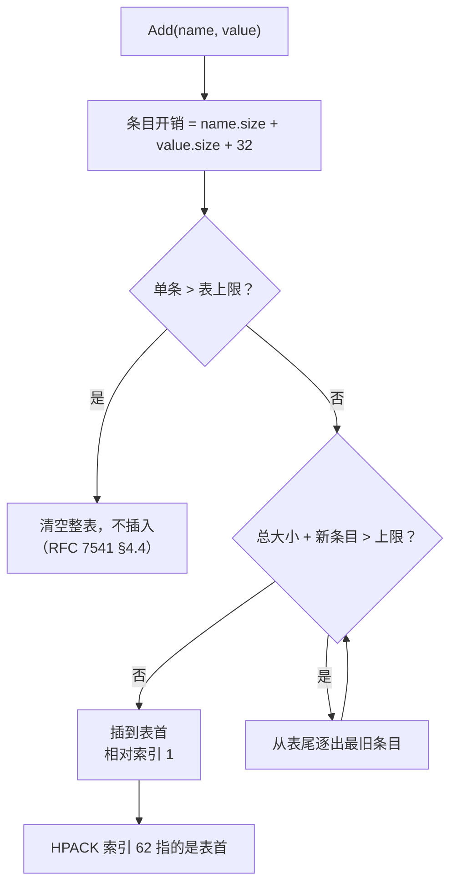

# G11 · HTTP/2 全栈（HPACK / 帧层 / 流状态机 / 连接层 / Transport）—— 一图看懂

> **本组与 G7 的 HTTP/1.1 并列在 L5（应用协议层）**，但内部自己又是一套小分层。
> 代码位置：`include/go2cpp/network/http2/` 与 `src/network/http2/`，共 **8 个头 + 6 个实现 + 1 个码表**，**3637 行**。
>
> **状态说明**：HTTP/2 是**已实现并验证**的（双向互通：curl/nghttp2 当客户端、Python 手写服务端当对端）。
> **QUIC / HTTP3 没有实现代码**，只有选型与阅读指南，见 §⑤ 与 `docs/quic-go-reading-guide.md`。

## ① 类架构：每个类用的底层能力 + 主要职责

### 1.1 协议分层与 `Transport` 解耦（本组最重要的设计）

**这张图要说明的一件事**：`Connection` 只认识 `Transport` 的三个方法，**完全不知道字节从哪来**。
所以协议逻辑可以在单线程内存缓冲上测完（`MemoryTransport`），再一行不改地接真实 socket
（`FiberTransport`）和 TLS（`TlsTransport`）。**并发只体现在 Transport 的实现里。**

### 1.2 连接层内部：流表 + 流控窗口

**为什么窗口用有符号 `int64`**：RFC 允许窗口在收到 `WINDOW_UPDATE` 之前**暂时为负**
（对端可能一次发来超过当前额度的 DATA）。用无符号会把它回绕成天文数字。

## ② 重要函数：功能与实现要点

### 2.1 `Connection::ReadEvent` —— 一帧进来后怎么走

### 2.2 `WriteData` —— 发送前的两道闸门

**注意点**：窗口不足时**立即返回错误**，不挂起等待。挂起需要 Fiber 条件变量，
是已知的后续工作（见 §⑤）。

## ③ 向上层提供了什么

**向上层提供了什么**（一句话）：一个**同步阻塞写法**的 HTTP/2 连接对象 ——
`ReadEvent()` 阻塞到下一件事发生，`WriteData()` 阻塞到写完，内部由 Fiber 挂起。

## ④ 状态流转

### 4.1 流的 7 个状态（RFC 9113 §5.1）

**两个容易搞反的方向**（本实现在 `test_stream_state.cpp` 用 84 组合穷举矩阵覆盖）：

- `half-closed(local)` —— **本地**关了，所以**不能发** DATA/HEADERS，但**还能收**；
- `half-closed(remote)` —— **对端**关了，所以**不能收**，但**还能发**。

**`idle` 上的 RST_STREAM 是协议错误**（RFC 规定 idle 只接受 HEADERS/PRIORITY），
不能在 idle 上直接关流。

### 4.2 一次请求穿过四层（含 CONTINUATION 与流控）

### 4.3 流控窗口的三个区（发送侧视角）

**接收侧是对称的**：收到 DATA 扣减本地窗口，**消耗超过一半**才发 `WINDOW_UPDATE` 补回。
每帧都补会让流控形同虚设，还会白花带宽（实测测试里 64+16 字节只触发 2 个 `WINDOW_UPDATE`，
流级与连接级各一）。

### 4.4 HPACK 动态表：插入 → 超限 → FIFO 逐出

内存在这里的取舍很实在：动态表**省的是重复 header 的字节数**，代价是要维护 FIFO
与索引语义；静态表 61 项是**编译期常量**，零成本，`FindStaticIndex` 一次线性扫描
就够（61 项、且高频命中的都在前面）。

## ⑤ 已实现 vs 只设计（必须分清）

| 能力 | 状态 | 证据 |
|---|---|---|
HPACK（静态表 61 + 动态表 + 整数前缀 + 三种字面量）| **已实现** | RFC 7541 §C.1/C.2/C.3 官方示例逐字节比对 |
Huffman 编解码（257 项码表）| **已实现** | `www.example.com` 编码逐字节匹配 §C.4.1 |
帧层（DATA/HEADERS/PRIORITY/RST_STREAM/SETTINGS/PUSH_PROMISE/PING/GOAWAY/WINDOW_UPDATE/CONTINUATION）| **已实现** | 10 场景 + 随机 3000 轮 |
流状态机（7 状态 + 84 组合矩阵）| **已实现** | 穷举矩阵 + 随机 5000 轮 |
连接层（握手 / 流表 / CONTINUATION / 流控）| **已实现** | 10 场景闭环 |
`MemoryTransport` / `FiberTransport` | **已实现** | socketpair 真实 IO 闭环 |
`TlsTransport`（TLS 1.2+ / SNI / ALPN=h2）| **已实现** | openssl s_server 实测 ALPN='h2' |
h2c 服务端 / 客户端示例 | **已实现** | 与 curl、Python 手写服务端双向互通 |

| 未做 | 原因 |
|---|---|
**QUIC / HTTP3** | **零实现代码**。只有选型与阅读指南（`docs/quic-go-reading-guide.md`）。quic-go 是 Go 库，C++ 无法直接链接 |
**HTTP/2 over TLS 完整链路** | 只验证到 TLS 层 + ALPN 协商；缺真正的 h2 TLS 服务器（nginx/nghttpd） |
**服务端 TLS** | 只做了客户端 |
**流控的阻塞等待** | 窗口不足立即返回 `kFlowControl`，不挂起等 `WINDOW_UPDATE` |
**DATA 分片** | 单帧超过 `max_frame_size` 返回 `kUnsupported`（HEADERS 有 CONTINUATION，DATA 没有对应机制） |
**优先级** | PRIORITY 能解析但不参与调度（RFC 9113 已弃用） |
**服务器推送 API** | PUSH_PROMISE 能解析，无推送接口 |
**会话复用 / 0-RTT** | 未做 |
**证书校验默认值** | `verify_peer=false` 是测试便利，**不是安全默认**，生产必须打开 |

## 与 Go 的差异

| 维度 | Go 的 `x/net/http2` | 本项目 |
|---|---|---|
IO 模型 | `net.Conn` 接口 + goroutine 阻塞 | `Transport` 接口 + Fiber 挂起。**抽象点相同**，实现不同 |
连接驱动 | 多个 goroutine（读/写/调度各一） | **单驱动者**：一个 Fiber 跑 `ReadEvent` 循环，写是同步的 |
流控等待 | 窗口不足时 `Write` 阻塞 | 立即返回 `kFlowControl`，由调用方重试 |
CONTINUATION | 由 header writer 自动处理 | `WriteHeaderBlock` 自动分片；接收侧 `AssembleHeaderBlock` 拼接 |
HPACK Huffman | 支持 | 支持（码表从 Go 的实现提取并校验） |
DATA 分片 | 自动按 `max_frame_size` 切 | **未做** |
优先级 | 已弃用（RFC 9113）| 能解析不调度 |
服务器推送 | 有 `Push` API | 只能解析 PUSH_PROMISE |

## 怎么读这一组图

1. **先看 1.1** —— 理解 `Transport` 为什么存在，这是整个 HTTP/2 模块能脱离网络测试的原因；
2. **再看 4.1** —— 流的 7 个状态，`half-closed` 两个方向最容易搞反；
3. **然后 2.1** —— 一帧进来后的完整分发路径，包含 CONTINUATION 与流控扣减；
4. **最后 ⑤** —— 哪些是真的、哪些只是设计，别把 QUIC 当成已实现。

## 维护约定（与 G1~G10 相同，另有两条本组特有）

1. 本组**一图至少包含**：协议分层、`ReadEvent` 分发、向上层提供、流状态机；
2. **`Transport` 是抽象边界**，画任何新 IO 实现都要画在 `Transport` 之下，不要画进 `Connection`；
3. **已实现 vs 只设计**这一节必须随代码更新 —— 这个项目最容易出现的问题是把"设计过"当成"实现过"；
4. 新增帧类型时，同时更新 2.1 的分发图与 ⑤ 的帧层清单。
