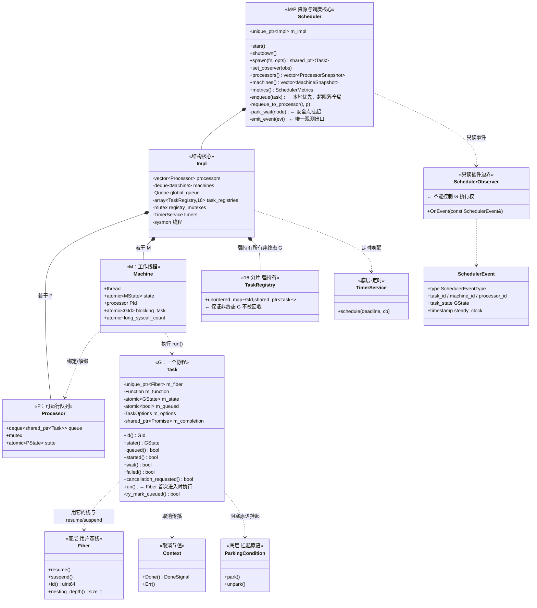
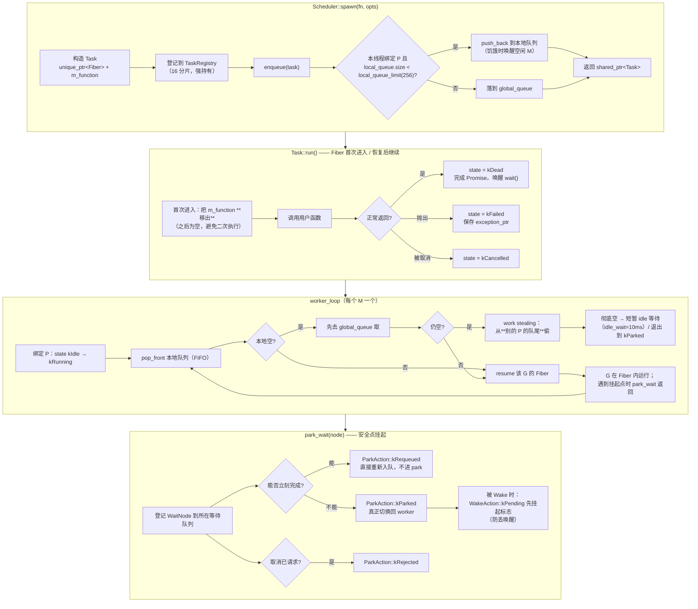
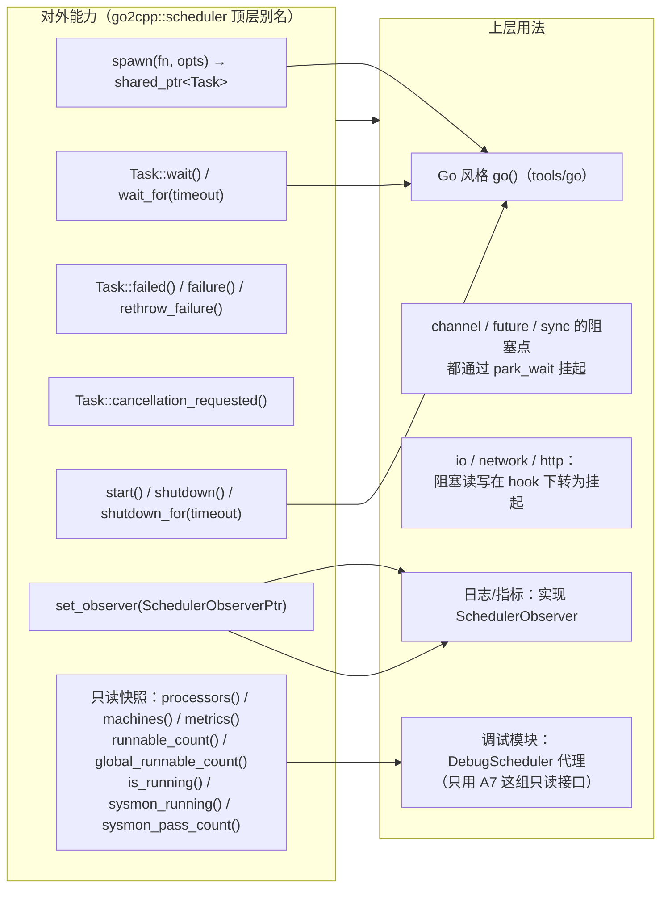
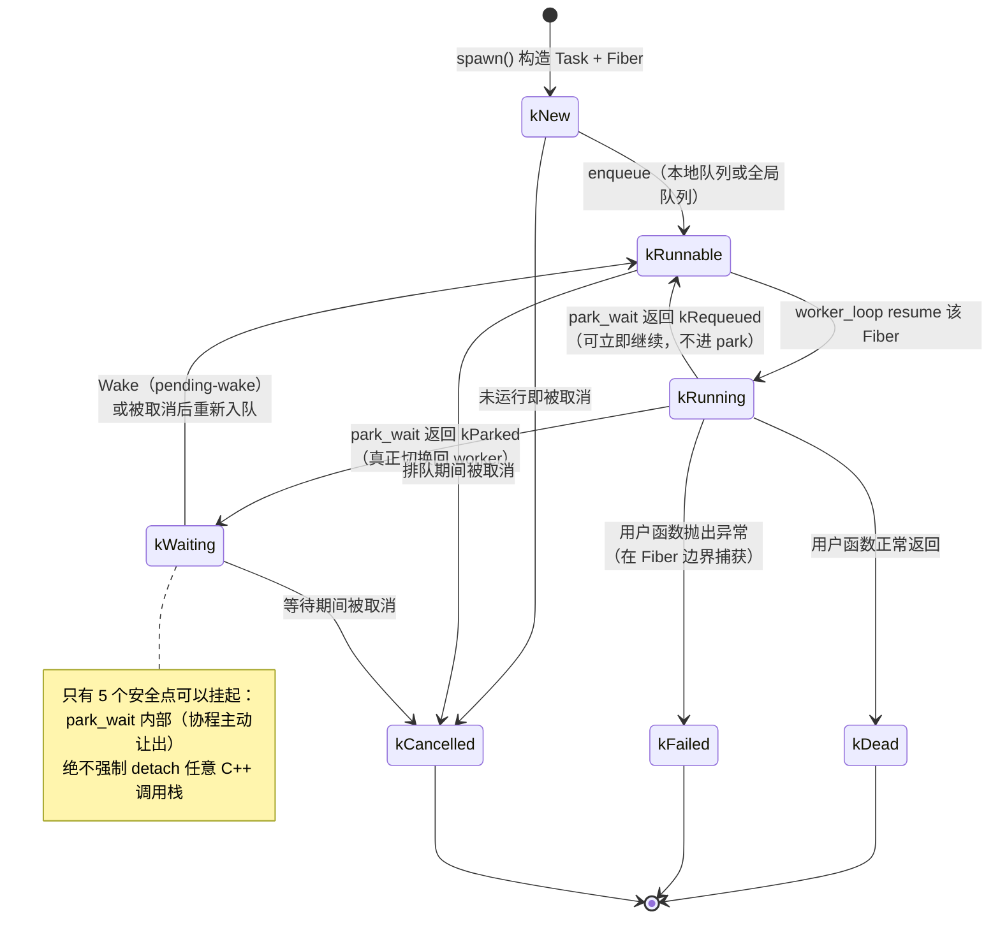
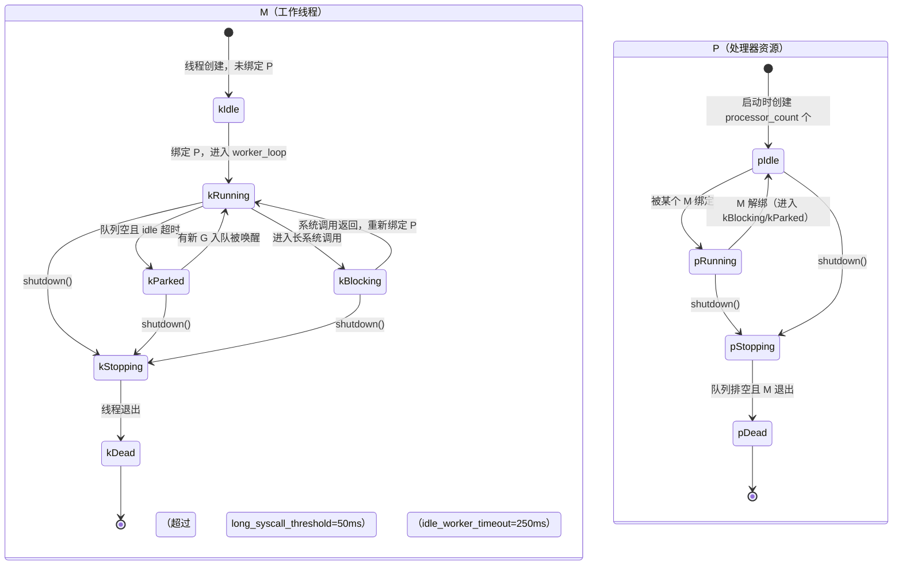

# G2 · GMP 调度模块 —— 一图看懂

> 覆盖：`Task`（= G）、`Scheduler`、P/M 资源、`worker_loop`、`sysmon`、`TaskRegistry`、`FiberBin`。
> 源码：`include/go2cpp/concurrency/scheduler/scheduler.hpp`、`src/concurrency/scheduler/scheduler.cpp`。

## ① 类架构：每个类用的底层能力 + 主要职责



**职责一句话总结**

| 类 | 主要职责 | 用到的底层能力 |
|---|---|---|
| `Fiber` | 提供**独立用户态栈**与 `resume/suspend`；只能协作式切换 | libc/pthread、`mmap` 栈 |
| `Task`(G) | 承载**一个协程**：入口函数、状态机、完成通知、取消请求 | `Fiber`、`Context`、`Promise`、原子量 |
| `Scheduler` | 对外 API：`start/shutdown/spawn`、观测出口 `emit_event` | 上述全部 |
| `Impl` | 真正的结构：P 数组、M 队列、**全局队列**、**16 分片注册表**、定时器、sysmon | `TimerService`、`std::mutex` |
| `Processor`(P) | 一个**可运行队列**（`deque`），本地 FIFO | 自身 `mutex` |
| `Machine`(M) | 一个**工作线程**，绑定/解绑 P，执行 G | `std::thread`、原子量 |
| `TaskRegistry` | **强持有**全部非终态 G，防止被误回收 | `unordered_map` + 分片锁 |
| `SchedulerObserver` | **只读**插件边界（不能控制 G） | — |

## ② 重要函数：功能与实现要点



**要点（这些都是源码里真实存在的约束）**

- `spawn` 的落点：**本地优先**（上限 `local_queue_limit`，默认 256），溢出才进 **全局队列**；
- 本地取用是 `pop_front()`（**FIFO**），而 **work stealing 从队尾偷**（降低与本地 FIFO 的冲突）；
- `Task::run` **第一次**进入时会把 `m_function` **移出**，之后为空 —— 保证用户函数只执行一次；
- `park_wait` 有三个结果而不是两个：`kRejected`（已请求取消）/ `kParked`（真挂起）/ `kRequeued`（可立即继续，**不进 park** 省一次切换）；
- 唤醒侧用 **pending-wake** 语义：先挂标志再 park，保证不丢唤醒；
- 全流程只有**一个观测出口** `emit_event`：它把 observer 的 `shared_ptr` 在短锁内拷出，**锁外**调用回调，并捕获一切异常（绝不因插件让 worker 线程异常退出）。

## ③ 向上层提供了什么



## ④ 状态流转：G / M / P

### G（Task）的状态机 —— 用户点名的"Fiber 如何在 Scheduler 流转"



### M（工作线程）与 P（处理器）的状态



## 附：一次 `spawn` 到结束的时序（ASCII，补充时序细节）

```
调用方线程                worker(M)                    Fiber(G)                注册表/Observer
    |                        |                            |                          |
    |-- spawn(fn) ---------->|                            |                          |
    |                        |-- 构造 Task+Fiber ---------|                          |
    |                        |-- 登记 TaskRegistry --------------------------------->|
    |                        |-- enqueue：本地队列 or 全局                           |
    |<- shared_ptr<Task> ----|                            |                          |
    |                        |                            |                          |
    |                        |-- pop_front() 取到 G ----->|                          |
    |                        |-- resume(Fiber) ---------->|                          |
    |                        |                            |-- 首次进入: 移出 m_function
    |                        |                            |-- 调用户函数              |
    |                        |                            |   (遇阻塞 -> park_wait)   |
    |                        |<-- park_wait 返回 kParked -|                          |
    |                        |   (切回 worker_loop)       |                          |
    |                        |                            |                          |
    |                        |   [被 Wake]                |                          |
    |                        |-- 重新入队 -> resume ----->|                          |
    |                        |                            |-- 继续执行直到返回        |
    |                        |<-- state=kDead ------------|                          |
    |                        |-- emit_event(kTaskCompleted) ------------------------->|
    |<- wait() 返回 ---------|                            |                          |
```

## 与 Go 的差异（必须知道，避免误用）

| 项 | Go | Go2Cpp |
|---|---|---|
| 抢占 | 有协作式抢占点（`asyncpreempt`） | **纯协作**：只能在 5 个安全点让出，长循环不主动让出会饿死同 P 的其他 G |
| G 栈 | 可增长（copy 栈） | `Fiber` 栈**固定大小**（`fiber_stack_size`），深递归会失败 |
| work stealing | 从**队尾偷一半** | 从**队尾偷一个** |
| 观测 | `runtime/trace` 丰富 | 只有 `SchedulerObserver` 的 9 类事件，**只读**、不能控制 G |
| 时钟 | `nanotime` | `steady_clock`，**不可跨机比较** |
