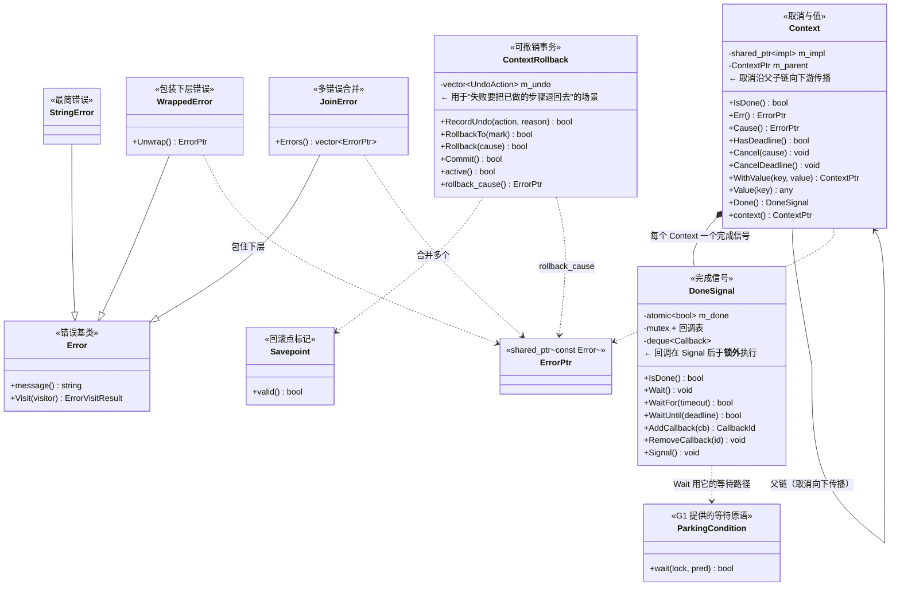
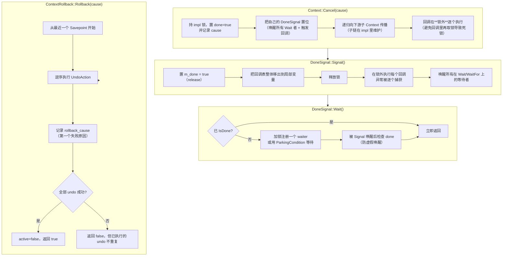
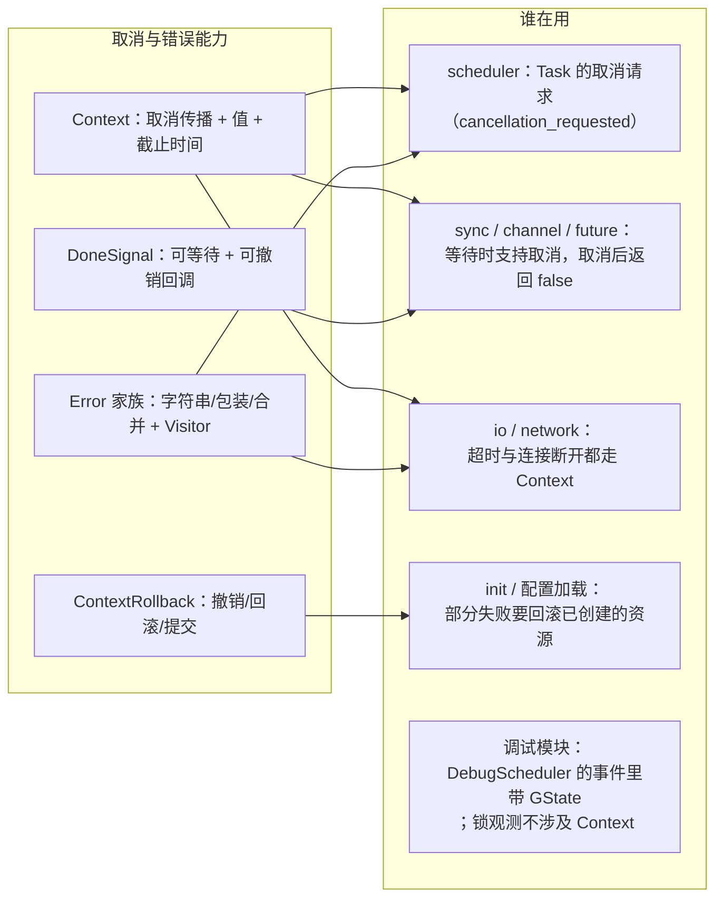
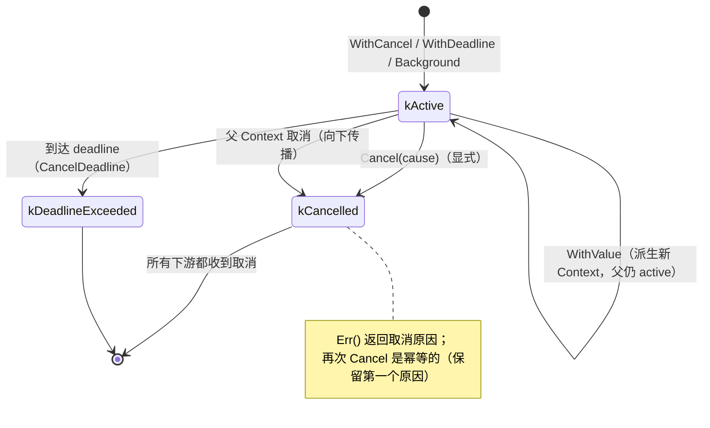
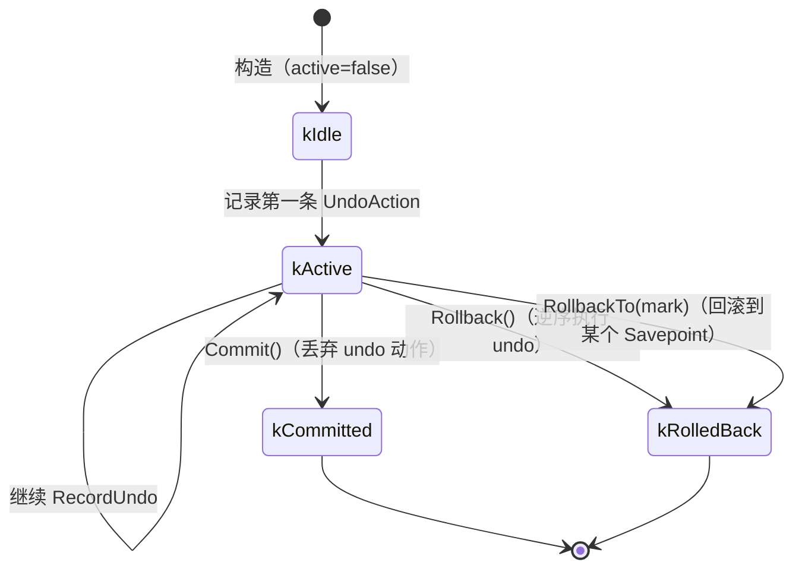

# G3 · 取消与错误 —— 一图看懂

> 覆盖：`Context`（取消传播 / 值 / 截止时间）、`DoneSignal`（完成信号与回调）、
> `ContextRollback`（可撤销的上下文事务）、`Error` / `ErrorPtr` / `StringError` / `WrappedError` / `JoinError`。
> 源码：`include/go2cpp/concurrency/context.hpp`、`tools/error.hpp`。

## ① 类架构：每个类用的底层能力 + 主要职责

| 类 | 主要职责 | 用的底层能力 |
|---|---|---|
| `DoneSignal` | 「这件事做完了/被取消了」的可等待信号；支持**回调注册**（`CallbackId` 可撤销） | 原子量、`mutex`、**`ParkingCondition`**（让受管 G 等着不占线程） |
| `Context` | 取消传播（父取消→子取消）、`WithValue` 存取值、截止时间 | `DoneSignal`、父链 `shared_ptr` |
| `ContextRollback` | 记录 undo 动作，失败时按 `Savepoint` 回滚已完成的步骤 | `Error`、`vector<UndoAction>` |
| `Error` 家族 | 错误类型；`StringError` 最简、`WrappedError` 可解包、`JoinError` 可合并 | `shared_ptr<const Error>` 不可变共享 |

## ② 重要函数：功能与实现要点

**要点**

- 回调必须**在锁外**执行：否则回调里再调 `AddCallback`/`Cancel` 就会自死锁；
- `Signal` 的回调表是**整体移出**再执行，保证"执行期间新注册的回调"不会被这次 Signal 触发（语义清晰）；
- `CallbackId` 可 `RemoveCallback`，用于"对象销毁前撤销悬挂回调"（`future.hpp` 里的 `FutureCallbackGuard` 就是干这个）；
- `Wait` 用 `ParkingCondition` 而不是裸 `condition_variable`，所以**受管 G 等待时不占工作线程**；
- `ContextRollback` 的 undo 是**逆序**执行，且记录第一个失败原因而不中断（尽力回滚）。

## ③ 向上层提供了什么

## ④ 状态流转

### Context 的生命周期

### ContextRollback 的状态

## 与 Go 的差异

| 项 | Go | Go2Cpp |
|---|---|---|
| `context.Context` | 接口 + `context.WithCancel` 等 | `Context` 具体类 + `ContextPtr` 共享 |
| 取消检查 | `select { case <-ctx.Done(): }` | `DoneSignal::Wait/IsDone`，或等待 API 的返回值 |
| 错误链 | `errors.Is/As` + `%w` | `WrappedError::Unwrap` + `Visit(visitor)` |
| 事务回滚 | 无标准库 | `ContextRollback`（多 undo 动作 + Savepoint） |
