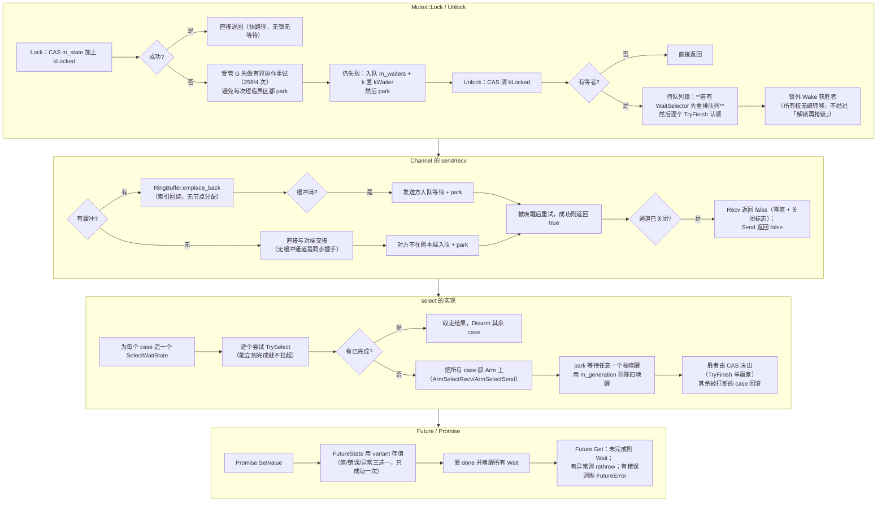
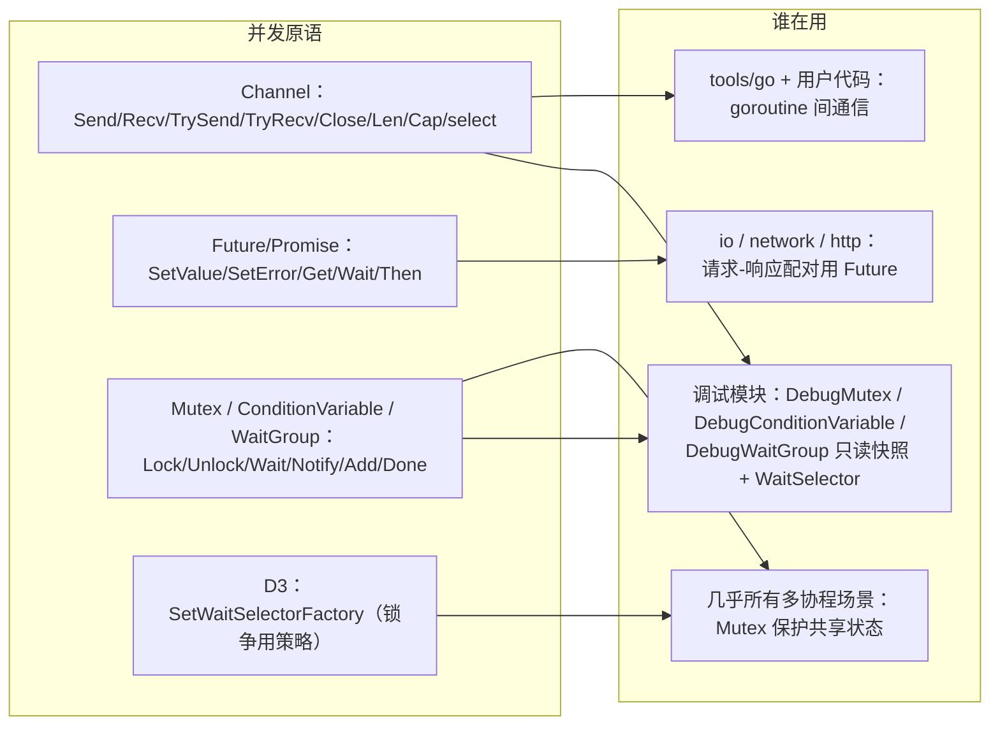
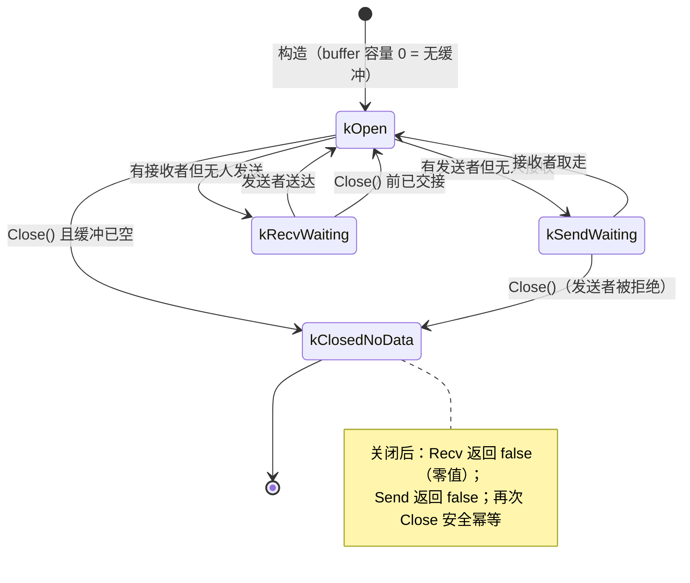
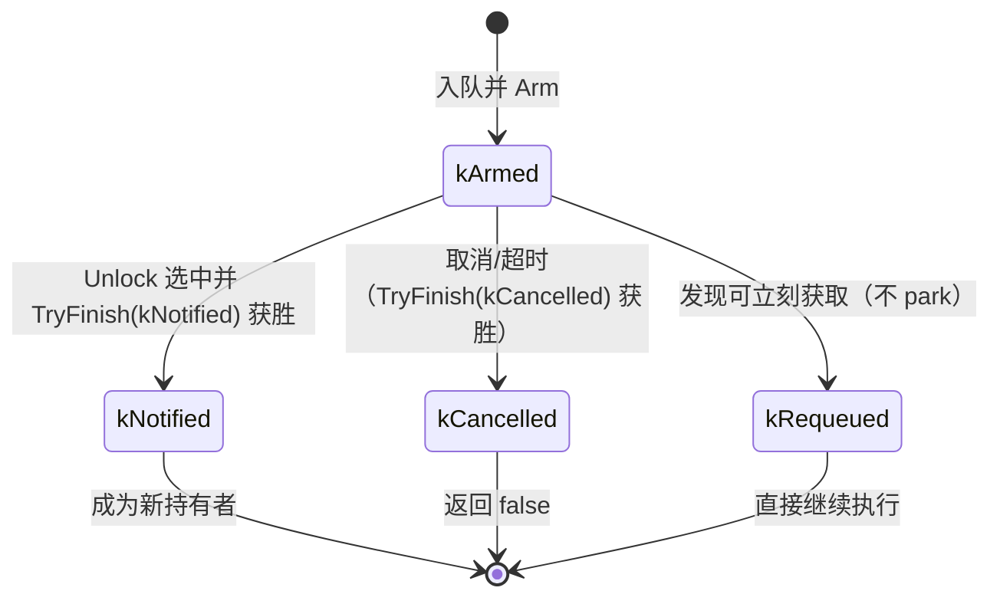

# G4 · 并发原语 —— 一图看懂

> 覆盖：`Channel<T>`（含 `RingBuffer` / `SelectWaitState` / `SelectValue`）、`Future` / `Promise` /
> `FutureState<T>`、`sync::Mutex` / `ConditionVariable` / `WaitGroup`、以及调试扩展 `WaitSelector`。
> 源码：`include/go2cpp/concurrency/channel.hpp`、`future.hpp`、`sync.hpp`。

## ① 类架构：每个类用的底层能力 + 主要职责

```mermaid
classDiagram
    direction TB

    class ParkingCondition {
        <<G1 等待原语>>
    }
    class Mutex {
        <<互斥锁>>
        -atomic~uint8~ m_state  (kLocked|kWaiter)
        -deque~shared_ptr~WaitNode~~ m_waiters
        +Lock(ctx) bool
        +TryLock() bool
        +Unlock() void
        +DebugSnapshotInternal() MutexDebugSnapshot
    }
    class ConditionVariable {
        <<条件变量>>
        -deque~shared_ptr~WaitNode~~ m_waiters
        +Wait(mutex, ctx) bool
        +WaitFor(mutex, timeout, ctx) bool
        +NotifyOne() void
        +NotifyAll() void
    }
    class WaitGroup {
        <<计数等待>>
        -int64 m_count
        -deque~shared_ptr~WaitNode~~ m_waiters
        +Add(delta) void
        +Done() void
        +Wait(ctx) bool
        +Count() int64
    }
    class WaitSelector {
        <<D3 争用选择钩子>>
        +Select(candidates) optional~size_t~
        ← 只重排队列顺序，不改认领语义
    }

    class RingBuffer {
        <<无锁环形队列>>
        -vector~T~ m_slots
        -atomic m_head/m_tail/m_count
        +emplace_back(args) bool
        +pop_front(out) bool
        +pop_back_rollback() bool
        ← 取代 std::deque，消除节点分配
    }
    class SelectWaitState {
        <<select 的等待状态>>
        +TrySelect() bool
        +TrySelectPair() bool
        +Take() SelectResult
        +ArmSelectRecv() / ArmSelectSend()
        +DisarmSelect()
    }
    class Channel {
        <<Go 风格通道>>
        -shared_ptr~RingBuffer~ m_buffer
        -deque~Sender~ / deque~Receiver~
        -atomic~uint64~ m_generation
        +Send(value) bool
        +Recv(out) bool
        +TrySend / TryRecv
        +Close()
        +Len() / Cap()
    }
    class FutureState {
        <<共享状态 T / void 特化>>
        -variant~T, ErrorPtr, exception_ptr~ m_value
        +SetValue / SetError / SetException
        +Cancel(error) bool
        +Wait(timeout)
    }
    class Promise {
        <<写端>>
        +SetValue(v)
        +SetError(e)
        +GetFuture() Future
    }
    class Future {
        <<读端>>
        +Get() T
        +Wait(timeout) bool
        +Then(cb)
        +Ok() / Ready() / TimedOut() / Cancelled()
    }

    Mutex ..> ParkingCondition : 等待走它（受管 G 不占线程）
    ConditionVariable ..> ParkingCondition
    WaitGroup ..> ParkingCondition
    Mutex ..> WaitSelector : Unlock 时若注册则重排队列
    Channel *-- RingBuffer : 有缓冲时用它
    Channel ..> SelectWaitState : select 的挂起状态
    Channel ..> ParkingCondition : 阻塞收发
    Promise --> FutureState : 写
    Future --> FutureState : 读
    FutureState ..> ParkingCondition : Wait 走它
    ConditionVariable ..> Mutex : Wait 必须持有 mutex
```

| 类 | 主要职责 | 用的底层能力 |
|---|---|---|
| `Mutex` | 互斥；**所有权可无缝转移**（A 加锁 B 解锁）；`TryLock` 不能插队 | 原子状态字节、`WaitNode` 队列、`ParkingCondition` |
| `ConditionVariable` | 条件等待；`NotifyOne` 与 `Mutex::Unlock` **同构** | `Mutex`、`WaitNode` |
| `WaitGroup` | 计数归零唤醒；计数下溢/溢出抛 `logic_error` | `ParkingCondition` |
| `WaitSelector` | **D3**：锁争用时决定谁先获得权限 —— **只重排队列**，不改认领语义 | 无（纯策略） |
| `RingBuffer` | 无缓冲节点分配的环形队列（取代 `std::deque`） | 原子 head/tail、索引回绕 |
| `Channel<T>` | Go 风格 send/recv/close/select；9 种状态 | `RingBuffer`、`SelectWaitState`、`ParkingCondition` |
| `FutureState<T>` | 共享状态：值 / 错误 / 异常三选一；`void` 特化 | `variant`、`ParkingCondition` |
| `Promise`/`Future` | 写端 / 读端分离 | `FutureState` |

## ② 重要函数：功能与实现要点

**要点**

- `Mutex::Lock` 的**快路径**只做一次 CAS —— 这是"无竞争几乎零成本"的原因；
- **受管 G 有有界协作重试**（源码注释里的 256/4 次）：短临界区不必每次 park，这是与"简单 park 实现"的关键差异；
- `Unlock` 的**所有权无缝转移**：不是"解锁→别人抢"，而是**直接认领下一个持有者**，因此 `TryLock` **不能插队**；D3 的 `WaitSelector` 只改**队列顺序**，所以这条语义不受影响；
- `RingBuffer` 用**索引回绕**（`emplace_back` 时 index+1 后判断越界再归零，不做取模），`pop_back` 只在回滚时用；
- `Channel` 用 `m_generation` 原子量防止"陈旧节点"的取消回调误伤新等待者；
- `select` 的正确性靠 **CAS 单赢家**（`WaitNode::TryFinish`）+ `generation` 守卫。

## ③ 向上层提供了什么

## ④ 状态流转

### Channel 的 9 种状态（`ChannelStatus`）

### Mutex 的等待者交接（`WaitNode` 的状态）

## 与 Go 的差异

| 项 | Go | Go2Cpp |
|---|---|---|
| channel 缓冲 | `hchan` 环形缓冲 + `sudog` 队列 | `RingBuffer`（索引回绕）+ 自定义 `WaitNode` 队列 |
| `select` | 运行时随机选可用 case | 逐个 TrySelect，**先到先得**；无随机化 |
| 锁 | `sync.Mutex`（可自旋 + 饥饿模式） | 无自旋；受管 G 用**有界协作重试**（256/4） |
| 锁争用策略 | 运行时内建 | **可插拔**（D3 `WaitSelector`），默认 FIFO |
| `Future` | `sync.WaitGroup` / channel 组合 | 独立的 `Promise`/`Future`（含 `void` 特化、`Then`） |
| `WaitGroup` | 计数 + `sudog` | 计数 + `WaitNode`，下溢/溢出抛 `logic_error` |
