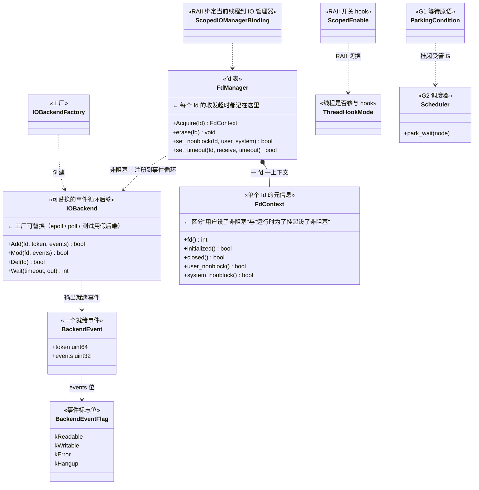
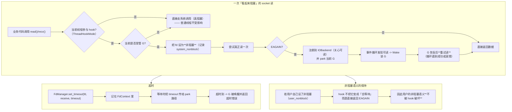
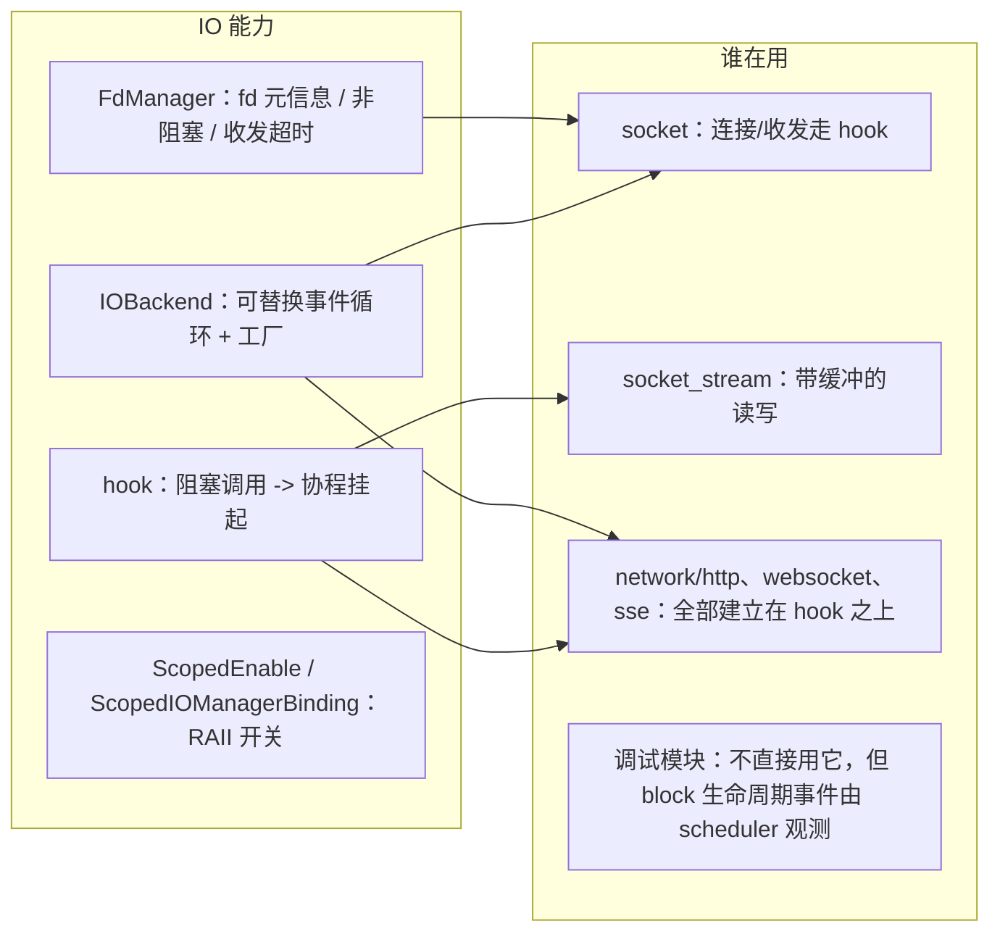
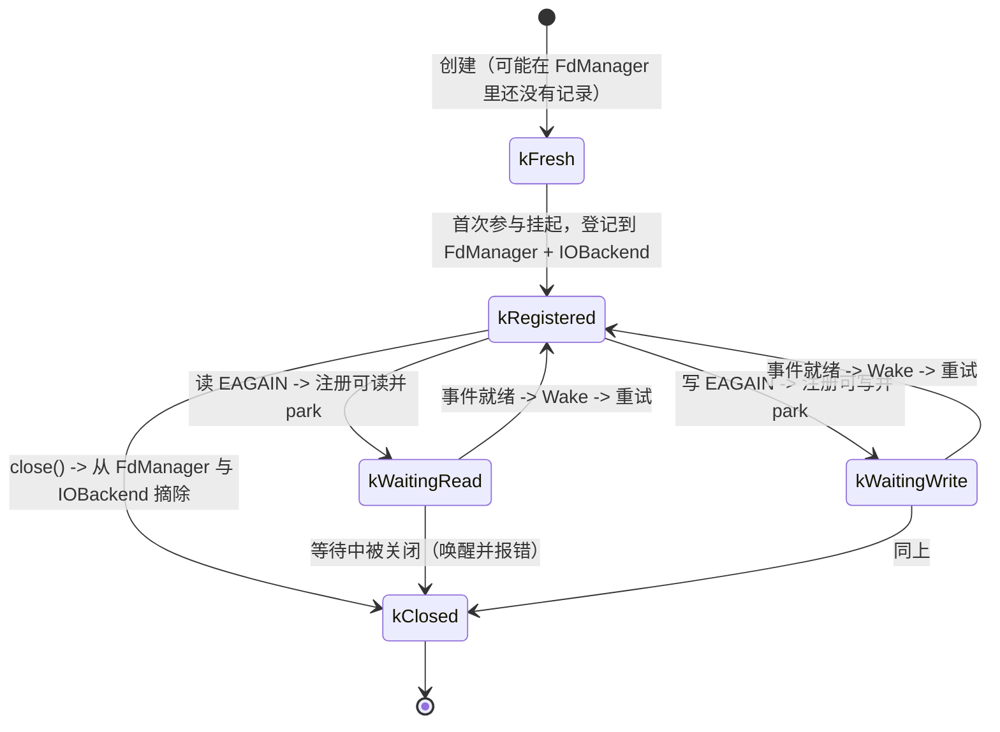
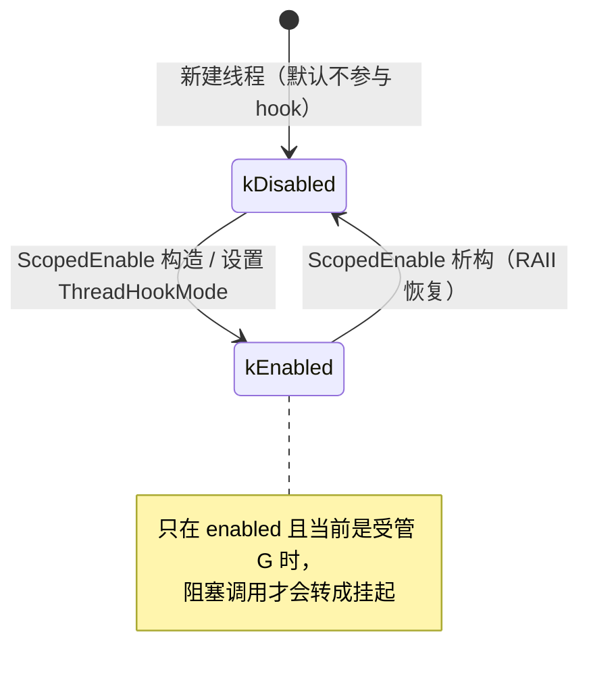

# G5 · IO 后端与文件描述符管理 —— 一图看懂

> 覆盖：`IOBackend`（可替换的事件循环后端）、`BackendEvent` / `BackendEventFlag`、
> `FdManager` / `FdContext`（fd 的元信息与超时）、`hook`（把阻塞系统调用转成协程挂起）。
> 源码：`include/go2cpp/network/io_backend.hpp`、`fd_manager.hpp`、`hook.hpp`。

**这一层解决的问题**：让"看起来阻塞"的 socket 读写**不阻塞工作线程**，
办法是**把 fd 设为非阻塞 + 交给事件循环 + 让当前 G 挂起**。

## ① 类架构：每个类用的底层能力 + 主要职责

| 类 | 主要职责 | 用的底层能力 |
|---|---|---|
| `IOBackend` | **可替换**的事件循环：注册/修改/删除 fd 监听，`Wait` 返回就绪事件 | `epoll`/`poll`（当前实现）、fd |
| `BackendEvent` / `BackendEventFlag` | 就绪事件与标志位（可读/可写/错误/挂断） | 无（纯数据） |
| `FdManager` | fd 的元信息表：是否非阻塞（**用户设置的**与**运行时设置的**分开记）、收发超时 | `FdContext` |
| `FdContext` | 单 fd 上下文；区分 `user_nonblock` 与 `system_nonblock` 是关键 | 无 |
| `hook`（`ScopedEnable` 等） | 把线程标记为"参与 hook"，从而让阻塞调用走"挂起"路径 | `ThreadHookMode`（线程局部） |

## ② 重要函数：功能与实现要点

**要点**

- **两套非阻塞标记**（`user_nonblock` / `system_nonblock`）：运行时为了挂起会把 fd 设成非阻塞，但**用户自己设的非阻塞不能因此变成"会等待"** —— 这个区分是正确性的关键；
- hook 只在**受管 G** 上生效（源码里 `BlockingRegion` 也只对 managed G 生效），普通线程仍走真阻塞；
- 挂起后**必须重试**读/写（因为事件就绪不等于一次能读够）；
- 超时记在 `FdContext`，不是每次调用传参。

## ③ 向上层提供了什么

## ④ 状态流转

### 一个 fd 在 hook 下的状态

### 线程的 hook 模式

## 与 Go 的差异

| 项 | Go | Go2Cpp |
|---|---|---|
| 事件循环 | `netpoll`（内部集成） | **可替换的 `IOBackend`**（工厂注入） |
| 阻塞转挂起 | 运行时自动接管所有 fd | 需线程**显式参与 hook**（`ThreadHookMode`） |
| 非阻塞语义 | 用户不可见 | **区分 user/system 两套标记**，用户语义不被破坏 |
| 超时 | `SetDeadline` 系列 | `FdManager::set_timeout`（按 fd 记录） |
