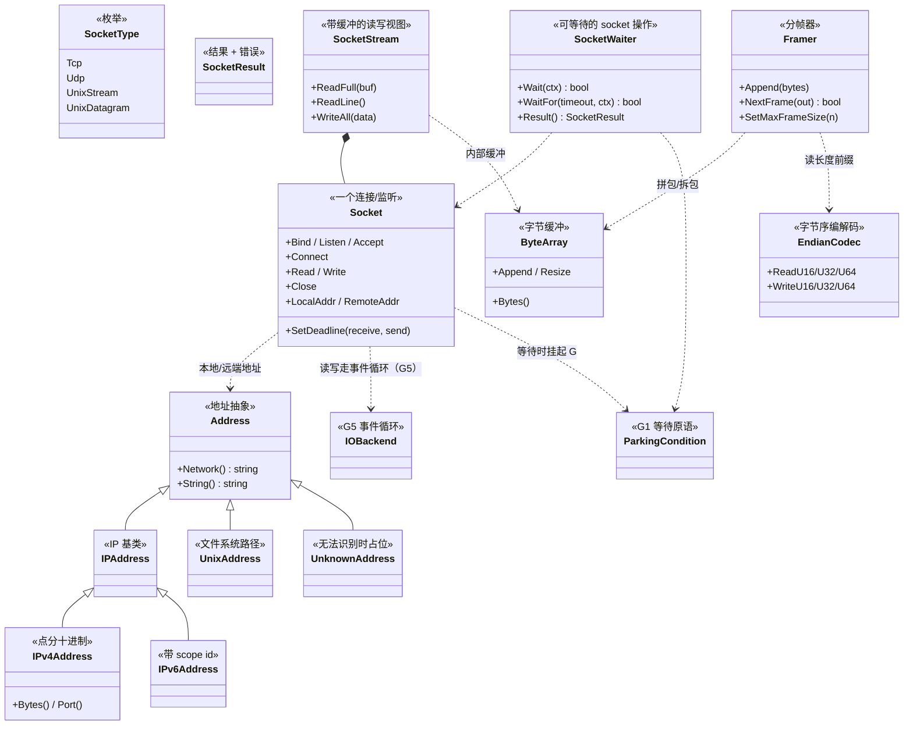
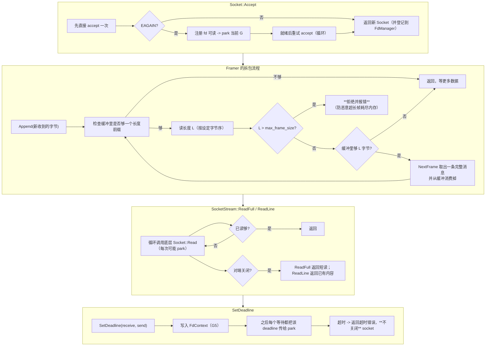
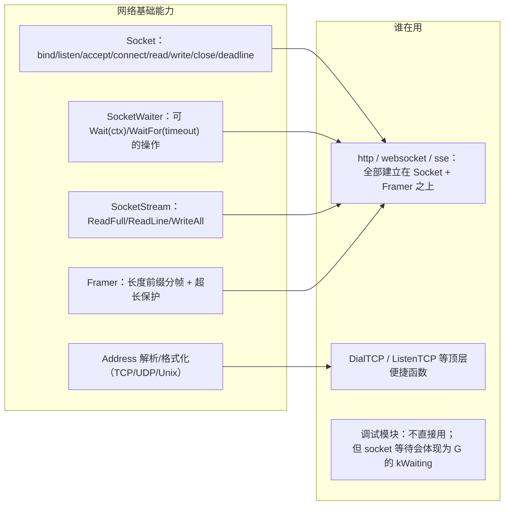
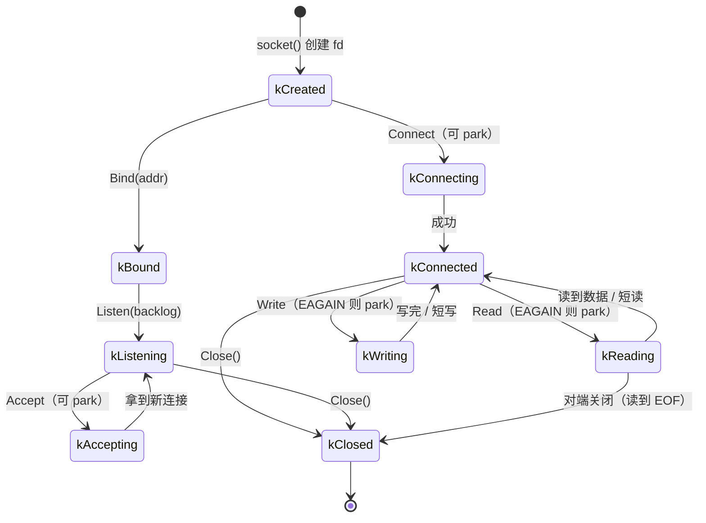
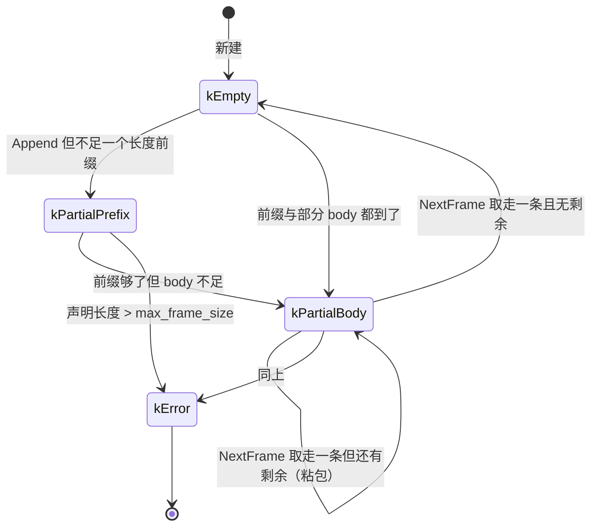

# G6 · 网络基础 —— 一图看懂

> 覆盖：`Address` 体系（`IPAddress`/`IPv4Address`/`IPv6Address`/`UnixAddress`/`UnknownAddress`）、
> `Socket`/`SocketResult`/`SocketType`/`SocketWaiter`、`SocketStream`、
> `Framer`（分帧）、`ByteArray`（字节缓冲）、`endian`（字节序）。
> 源码：`include/go2cpp/network/address.hpp`、`socket.hpp`、`framing.hpp`、`byte_array.hpp`、`endian.hpp`。

## ① 类架构：每个类用的底层能力 + 主要职责

| 类 | 主要职责 | 用的底层能力 |
|---|---|---|
| `Address` 体系 | 地址抽象：TCP/UDP/Unix，`String()` 与解析 | 系统 `sockaddr` 转换 |
| `Socket` | 一个 fd 的面向对象封装：bind/listen/accept/connect/read/write/close | **G5 的 hook + IOBackend**、`ParkingCondition` |
| `SocketWaiter` | 把"一次可能阻塞的操作"做成**可 `Wait(ctx)`/`WaitFor(timeout)`** 的对象 | `ParkingCondition` |
| `SocketStream` | 在 `Socket` 上提供 `ReadFull`/`ReadLine`/`WriteAll` 这类便利方法 | 内部 `ByteArray` |
| `Framer` | **分帧**：把字节流切成一条条消息（长度前缀 / 分隔符，含 `max_frame_size` 保护） | `ByteArray`、`EndianCodec` |
| `ByteArray` | 可增长的字节缓冲 | `std::vector<char>` 类设施 |
| `EndianCodec` | 大小端读写 | 位运算 |

## ② 重要函数：功能与实现要点

**要点**

- `Accept`/`Read`/`Write` 都是 **"先试一次，EAGAIN 就注册事件 + park，就绪后重试"** 的循环 —— 这是 hook 的标准形态；
- **`Framer` 的 `max_frame_size` 是安全边界**：没有它，一个声明了 4GB 长度的帧就能把内存吃光；
- `SetDeadline` **只影响等待**，超时**不关闭** socket（与 Go 的 `SetDeadline` 语义一致）；
- `SocketStream` 的 `ReadFull` 在**对端提前关闭**时返回**短读**，而不是无限循环等；
- 分帧的**长度字段字节序可配置**（`EndianCodec`），跨语言协议要显式约定。

## ③ 向上层提供了什么

## ④ 状态流转

### 一个 Socket 的生命周期

### Framer 的缓冲状态

## 与 Go 的差异

| 项 | Go | Go2Cpp |
|---|---|---|
| socket 抽象 | `net.Conn` 接口 | 具体类 `Socket` + `SocketStream` |
| 分帧 | 需第三方或手写 | 内置 `Framer`（长度前缀 + `max_frame_size` 保护） |
| 超时 | `SetDeadline/SetReadDeadline` | `Socket::SetDeadline(receive, send)`（记在 `FdContext`） |
| 地址 | `net.Addr` 接口 | `Address` 继承体系（`IPv4`/`IPv6`/`Unix`/`Unknown`）|
| 字节序 | `encoding/binary` | `EndianCodec`（大小端读写） |
