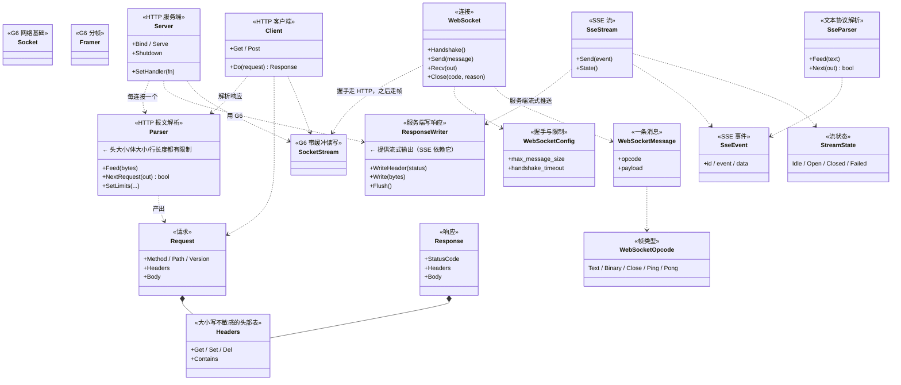
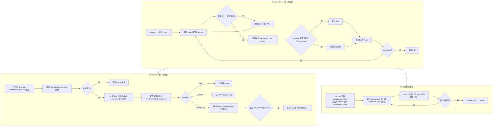
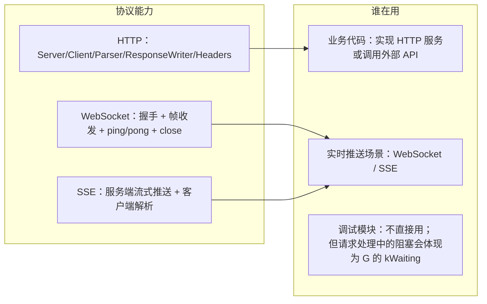
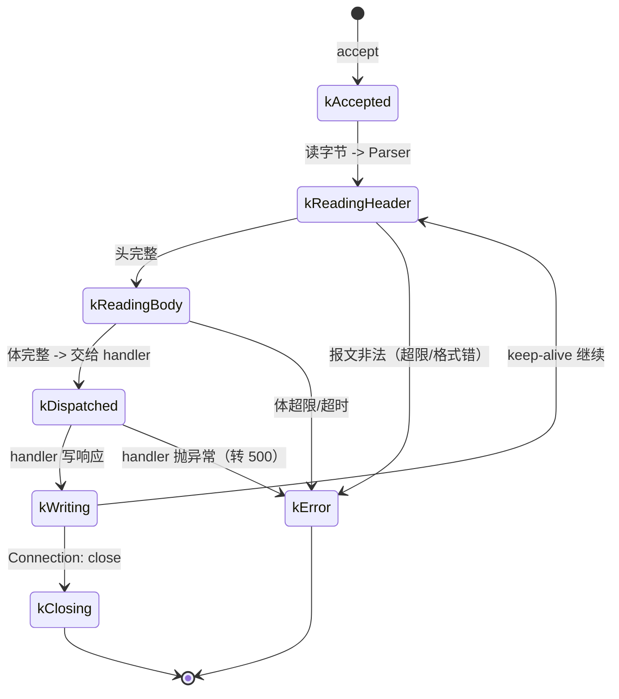
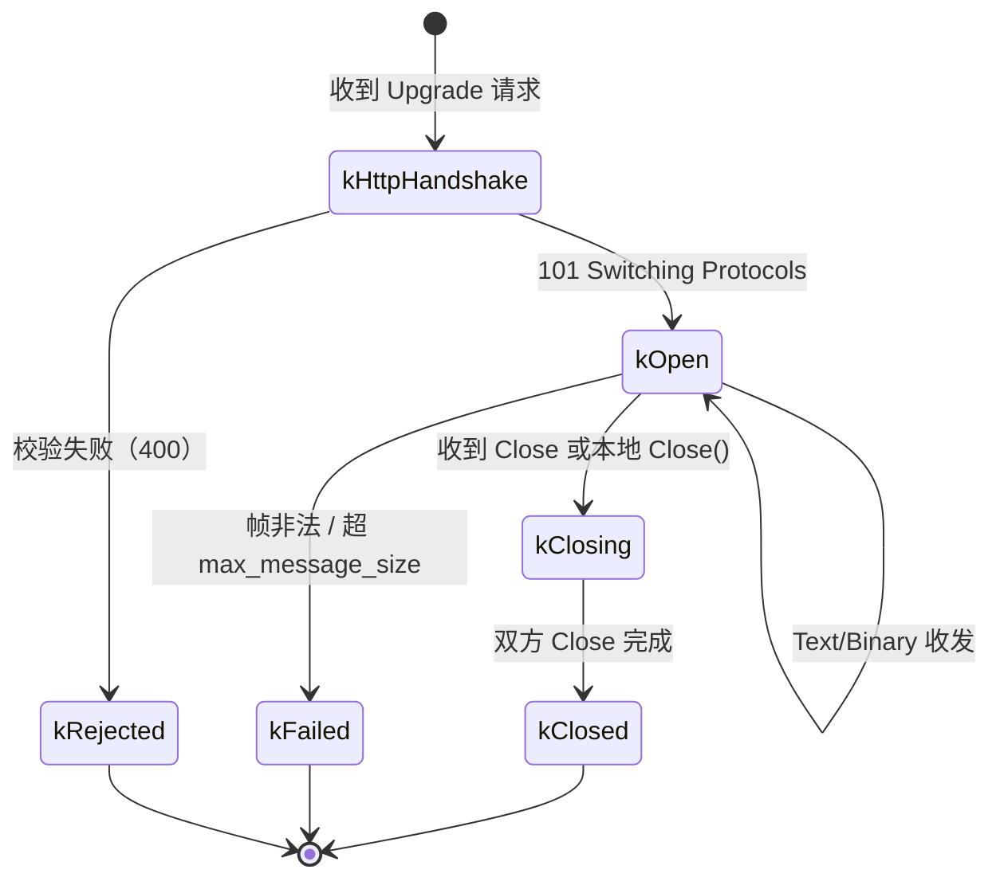
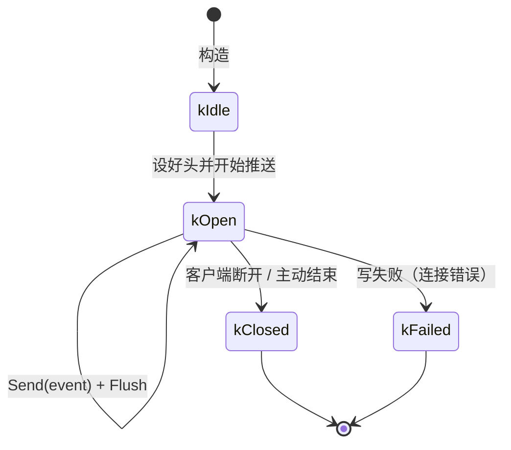

# G7 · 应用协议（HTTP / WebSocket / SSE）—— 一图看懂

> 覆盖：`http`（`Headers`/`Request`/`Response`/`Parser`/`Client`/`ResponseWriter`/`Server`）、
> `websocket`（`WebSocket`/`WebSocketMessage`/`WebSocketOpcode`/`WebSocketConfig`/`WebSocketRole`/
> `WebSocketError`/`WebSocketResult`）、`sse`（`Event`/`Parser`/`Stream`/`StreamState`/`StreamOptions`/
> `ParserLimits`/`Result`/`Error`）。
> 源码：`include/go2cpp/network/http.hpp`、`websocket.hpp`、`sse.hpp`。

## ① 类架构：每个类用的底层能力 + 主要职责

| 类 | 主要职责 | 用的底层能力 |
|---|---|---|
| `Headers` | HTTP 头表（**大小写不敏感**） | 哈希表 + 规范化 |
| `Parser` | 把字节流解析成 `Request`/`Response`；**带各处大小限制** | `ByteArray`、`Framer` 式增量解析 |
| `Server`/`Client` | 监听/发起；把连接包装成可复用的读写 | **G6 的 `Socket`/`SocketStream`**、hook |
| `ResponseWriter` | 写状态行/头/体，支持 `Flush` 做**流式输出** | `SocketStream` |
| `WebSocket` | 握手（HTTP Upgrade）+ 帧编解码 + ping/pong/close | `SocketStream`、`WebSocketConfig` 限制 |
| `SseParser`/`SseStream` | 解析/生成 `text/event-stream` 文本协议 | `ResponseWriter`（服务端）、`SocketStream`（客户端） |

## ② 重要函数：功能与实现要点

**要点**

- `Parser` **必须有各处上限**（头大小、体大小、行长）：否则一个恶意超长头就能耗尽内存 ——
  这与 G6 里 `Framer::max_frame_size` 是同一类防护；
- HTTP 的 `Headers` 查找**大小写不敏感**（协议要求）；
- `WebSocket` 的 `Ping` **自动回 `Pong`**，用户不用处理；
- `WebSocketConfig::max_message_size` 同样防内存耗尽（帧可以声明很大的长度）；
- **SSE 必须 `Flush`**：不 flush 的话数据留在用户态缓冲里，客户端根本收不到 ——
  这是 SSE 最容易踩的坑，图上专门标出。

## ③ 向上层提供了什么

## ④ 状态流转

### 一次 HTTP 连接

### WebSocket 连接

### SSE 流

## 与 Go 的差异

| 项 | Go | Go2Cpp |
|---|---|---|
| HTTP 服务端 | `net/http`（`http.Handler` 接口 + `ServeMux`） | `http::Server` + 函数式 handler + `ResponseWriter` |
| 头部大小写 | `textproto.CanonicalMIMEHeaderKey` | `Headers` 内部规范化，查找不敏感 |
| WebSocket | 第三方库（`gorilla/websocket` 等） | **内置** `WebSocket`（含握手、ping/pong、close） |
| SSE | 手写 `text/event-stream` | **内置** `sse::Stream` + `Parser` |
| 限制防护 | 由库或用户设置 | `ParserLimits`、`WebSocketConfig::max_message_size` **默认存在** |
