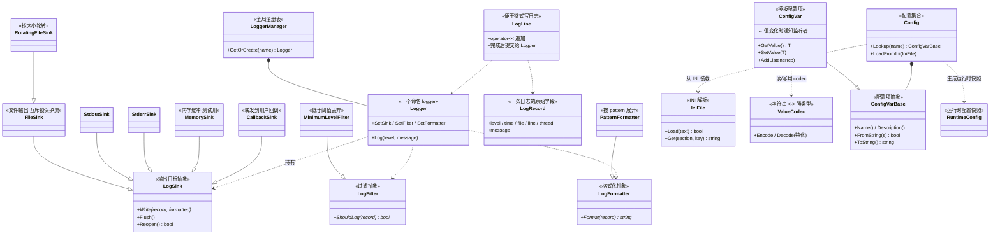
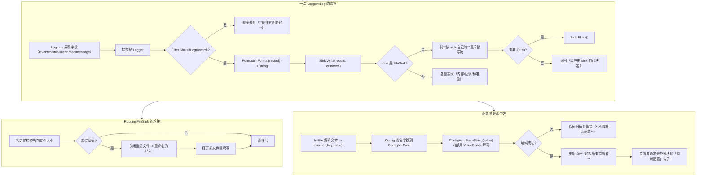
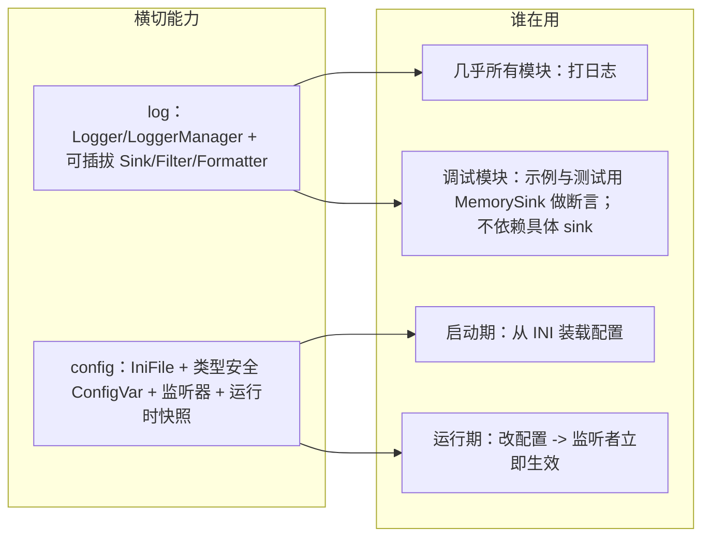
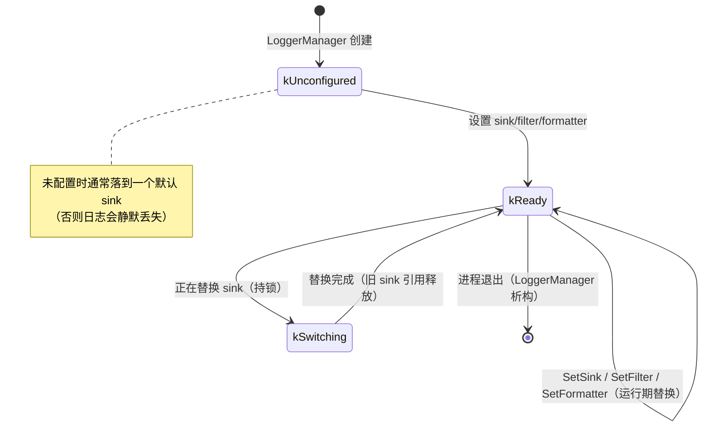
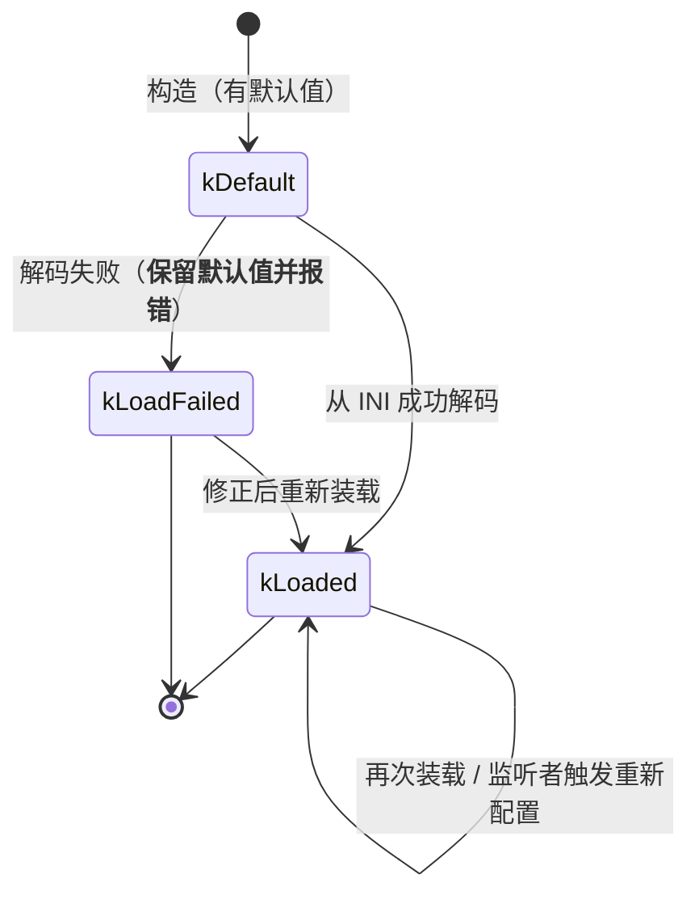

# G8 · 横切设施（日志 / 配置）—— 一图看懂

> 覆盖：`log`（`LogSink`/`LogFilter`/`LogFormatter` 三个**基类**及其派生：`FileSink`/`RotatingFileSink`/
> `StdoutSink`/`StderrSink`/`MemorySink`/`CallbackSink`/`MinimumLevelFilter`/`PatternFormatter`，
> 以及 `Logger`/`LoggerManager`/`LogRecord`/`LogLine`）、
> `config`（`IniFile`/`ValueCodec<T>`/`ConfigVarBase`/`ConfigVar<T>`/`Config`/`RuntimeConfig`）。
> 源码：`include/go2cpp/logging/log.hpp`、`config/config.hpp`。

**为什么放在一起**：两者都是**被几乎所有模块使用**的横切设施，而且都靠
"**抽象基类 + 可替换实现**"来避免上层依赖具体后端。

## ① 类架构：每个类用的底层能力 + 主要职责

| 类 | 主要职责 | 用的底层能力 |
|---|---|---|
| `LogSink` | **输出目标抽象**（写/刷新/重开） | 纯虚接口 |
| `FileSink` / `RotatingFileSink` | 写文件 / 按大小轮转 | `std::ofstream` + **互斥锁**（多线程安全） |
| `StdoutSink` / `StderrSink` | 标准输出/错误 | libc 流 |
| `MemorySink` | 内存里留最近 N 条（**测试与自检用**） | 环形缓冲 |
| `CallbackSink` | 转发给用户回调（接外部系统） | `std::function` |
| `LogFilter` / `MinimumLevelFilter` | 过滤（低于阈值丢弃） | 级别比较 |
| `LogFormatter` / `PatternFormatter` | 格式化（按 pattern 展开字段） | 字符串替换 |
| `Logger` / `LoggerManager` | 命名 logger 与全局注册表 | 互斥锁 + map |
| `ConfigVar<T>` | 类型安全的配置项，**值变化通知监听者** | `ValueCodec<T>` 特化 |
| `Config` / `IniFile` | 从 INI 装载、按名字查找 | 解析器 |

## ② 重要函数：功能与实现要点

**要点**

- **过滤在格式化之前**：被过滤掉的日志**不做字符串格式化**，这是最主要的热路径优化；
- 每个 `FileSink` 用**自己的互斥锁**保护流对象，所以多个不同的 sink 之间不互相阻塞；
- `RotatingFileSink` 在**写之前**检查大小（而不是写完再检查），保证单个文件不超阈值太多；
- `ConfigVar` 的值变化会**通知监听者**，所以"改了配置立即生效"不需要轮询；
- **解码失败保留旧值并报错**，绝不静默丢弃配置 —— 这类"静默降级"是配置系统最常见的事故来源。

## ③ 向上层提供了什么

## ④ 状态流转

### 一个 Logger 的配置状态

### ConfigVar 的生命周期

## 与 Go 的差异

| 项 | Go | Go2Cpp |
|---|---|---|
| 日志 | `log` / `slog`（Handler 接口） | `LogSink`/`LogFilter`/`LogFormatter` **三个独立抽象** |
| 轮转 | 第三方（`lumberjack`） | **内置** `RotatingFileSink` |
| 测试用 sink | 需自己实现 | **内置** `MemorySink` |
| 配置 | 第三方（viper 等） | **内置** `IniFile` + 类型安全 `ConfigVar<T>` + 监听器 |
| 配置错误 | 由库决定 | **保留旧值并报错，不静默降级** |
