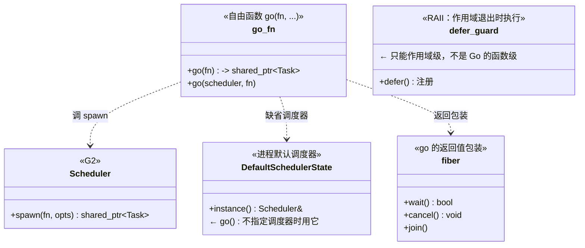
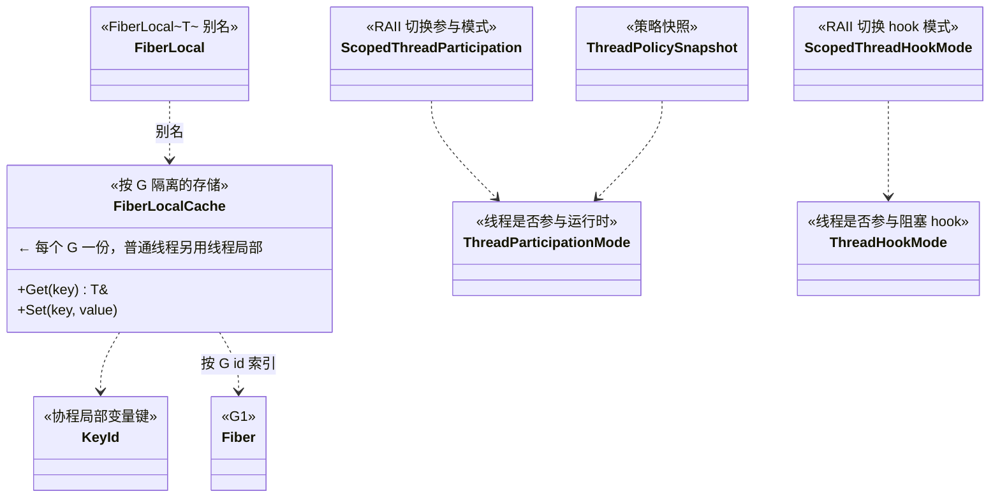
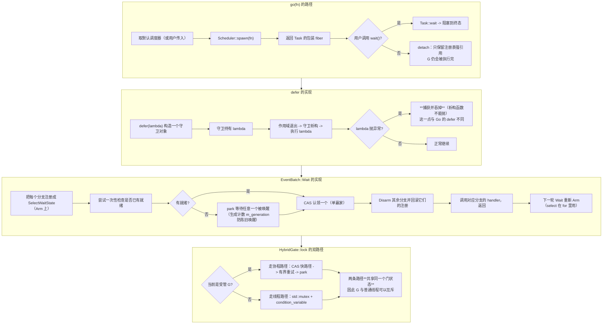
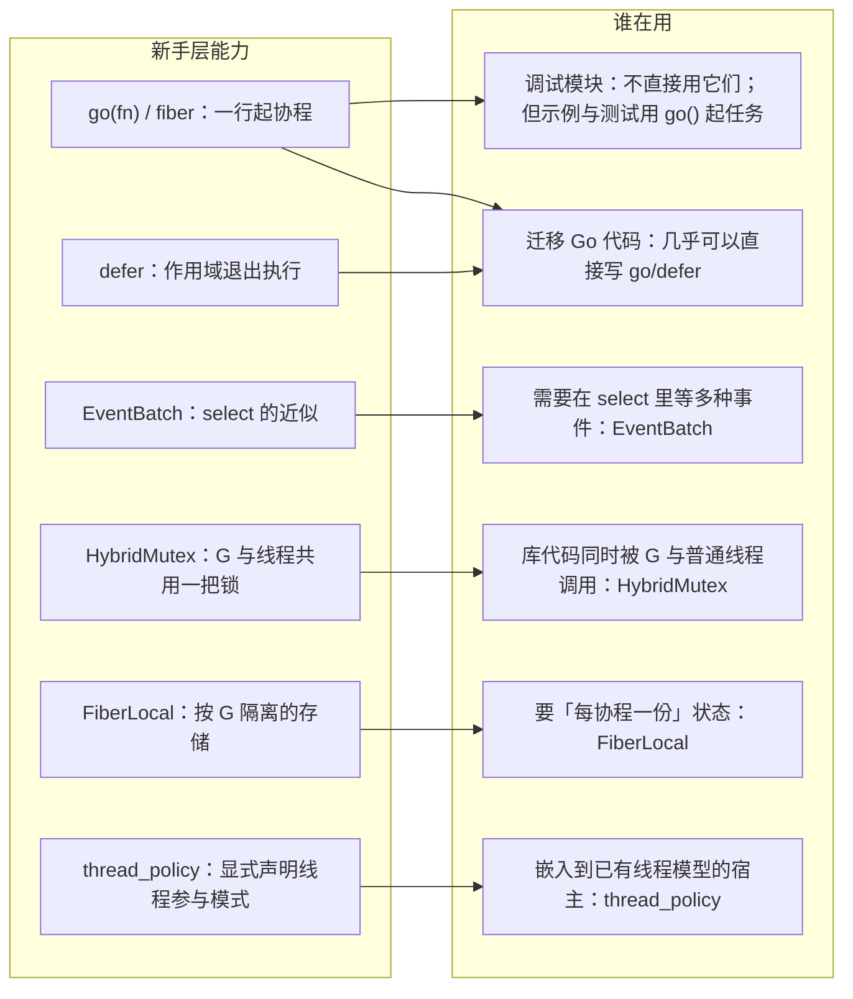
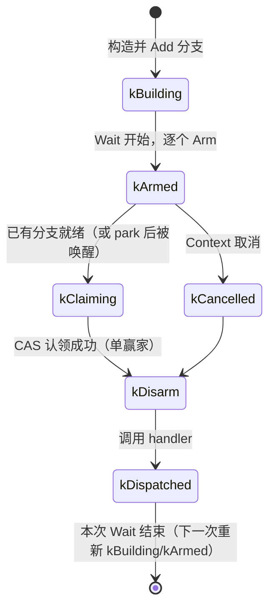
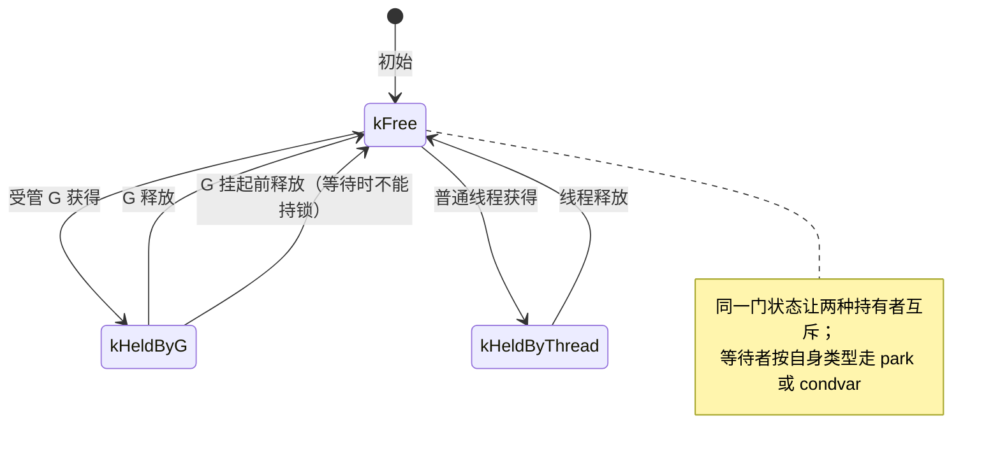

# G9 · 工具与新手层 —— 一图看懂

> 覆盖：`tools/go`（`go()` / `fiber` / `DefaultSchedulerState`）、`tools/control_flow`（`defer`）、
> `tools/event`（`EventBatch` / `SelectLoop`）、`core/hybrid_mutex`（`HybridGate` / `HybridMutex`）、
> `fiber_local`（`FiberLocalCache` / `FiberLocal<T>`）、`thread_policy`
> （`ThreadParticipationMode` / `ThreadHookMode` / `ThreadPolicySnapshot` /
> `ScopedThreadParticipation` / `ScopedThreadHookMode`）。
> 源码：`include/go2cpp/tools/go.hpp`、`tools/control_flow.hpp`、`tools/event.hpp`、
> `concurrency/core/hybrid_mutex.hpp`、`concurrency/fiber_local.hpp`、`concurrency/thread_policy.hpp`。

**这一层是「让 Go 代码几乎原样能编译」的那一层** —— 提供 `go`、`defer`、`select` 的近似物，
以及"这个线程要不要参与运行时"的显式控制。

## ① 类架构：每个类用的底层能力 + 主要职责

> 本模块共 **18 个类型**，一次性画会被 Mermaid 横向铺开（实测 784×230，文字不可读）。
> 按职责拆成 **3 张**（每张 5~7 类，一屏可读）。

### ①-A 启动协程：`go()` 与 `defer`

### ①-B `select` 近似物与混合互斥

```mermaid
classDiagram
    direction TB

    class Channel {
        <<G4>>
    }
    class TimerService {
        <<G1>>
    }
    class Context {
        <<G3>>
    }
    class ParkingCondition {
        <<G1>>
    }
    class EventBatch {
        <<select 的近似物>>
        +AddChannel(ch, op, handler)
        +AddTimer(deadline, handler)
        +AddContext(ctx, handler)
        +Wait()
        ← 每次 Wait 只取一个就绪事件
    }
    class SelectLoop {
        <<EventBatch 的别名>>
    }
    class HybridGateOptions {
        <<策略>>
    }
    class HybridGate {
        <<混合互斥：G 用 park，普通线程用 condvar>>
        +lock / unlock
        +try_lock
    }
    class HybridMutex {
        <<HybridGate 的别名>>
    }

    SelectLoop ..> EventBatch : 别名
    EventBatch ..> Channel : 监听可读/可写
    EventBatch ..> TimerService : 定时分支
    EventBatch ..> Context : 取消分支
    HybridMutex ..> HybridGate : 别名
    HybridGate ..> ParkingCondition : 受管 G 路径
    HybridGateOptions ..> HybridGate : 配置
```

### ①-C 协程局部存储与线程参与策略

**类职责汇总（18 个类型）**

| 类/函数 | 主要职责 | 用的底层能力 |
|---|---|---|
| `go(fn)` / `go(scheduler, fn)` | Go 风格启动协程；返回可 `wait`/`cancel` 的 `fiber` | `Scheduler::spawn`、`DefaultSchedulerState` |
| `DefaultSchedulerState` | 未显式传 scheduler 时的进程级默认实例 | `Scheduler` |
| `fiber` | `go()` 的返回值包装，提供 `wait`/`cancel`/`join` | `Task` |
| `defer` | **作用域退出时执行**的 RAII 守卫 | 析构函数 |
| `EventBatch`（`SelectLoop`） | `select` 的近似：注册多个 channel/timer/context 分支，`Wait` 取**一个**就绪 | `Channel`、`TimerService`、`Context` |
| `HybridGate`（`HybridMutex`） | **两种等待路径**：受管 G 走 park（不占线程），普通线程走原生 condvar | `ParkingCondition` + `std::mutex` |
| `FiberLocalCache`（`FiberLocal<T>`） | 按 **G** 隔离的存储（普通线程则按线程隔离） | G id → 值表 |
| `KeyId` | 协程局部变量的键类型 | 无 |
| `ThreadParticipationMode` / `ThreadHookMode` | 声明「这个线程参不参与运行时 / hook」 | 线程局部标志 |
| `ThreadPolicySnapshot` | 策略快照（用于观测） | 无 |
| `ScopedThreadParticipation` / `ScopedThreadHookMode` | RAII 切换并自动恢复 | 线程局部标志 |

## ② 重要函数：功能与实现要点

**要点（含与 Go 的真实差异）**

- `defer` 是 **RAII**：它绑定**作用域**，不是 Go 的"函数退出"；并且**析构函数不能抛异常**，所以 defer 里的异常会被吞掉 —— 这是**必须知道的行为差异**；
- `go(fn)` 不 `wait` 时 G 仍会被执行完（注册表强持有），但**没有句柄可以取消**；
- `EventBatch::Wait` 每次只取**一个**就绪分支，所以典型用法是 `while (true) { batch.Wait(); }`；
- `select` 的"随机选一个就绪分支"**没有实现**（本项目是**先到先得**），这一点在 G4 里也标注过；
- `HybridGate` 的价值是**同一把锁既能给 G 用、也能给普通线程用**，且两条路径共享同一个门状态。

## ③ 向上层提供了什么

## ④ 状态流转

### EventBatch 的一次 Wait

### HybridMutex 的双路径

## 与 Go 的差异

| 项 | Go | Go2Cpp |
|---|---|---|
| `defer` | **函数级**，可多次、逆序执行，panic 时也执行 | **RAII 作用域级**；析构不抛，异常被吞 |
| `select` | 多个就绪分支**随机选一个** | `EventBatch`：**先到先得**，无随机化 |
| `goroutine` 句柄 | 无（不能 wait/cancel 单个 goroutine） | `fiber` 可 `wait`/`cancel` |
| 协程局部存储 | 无（要靠显式传参） | `FiberLocal<T>` |
| 跨线程锁 | 无 `HybridMutex` 概念 | `HybridMutex`：G 与普通线程共用一把锁 |
| 线程参与 | 运行时不区分 | `thread_policy` 显式声明 |
