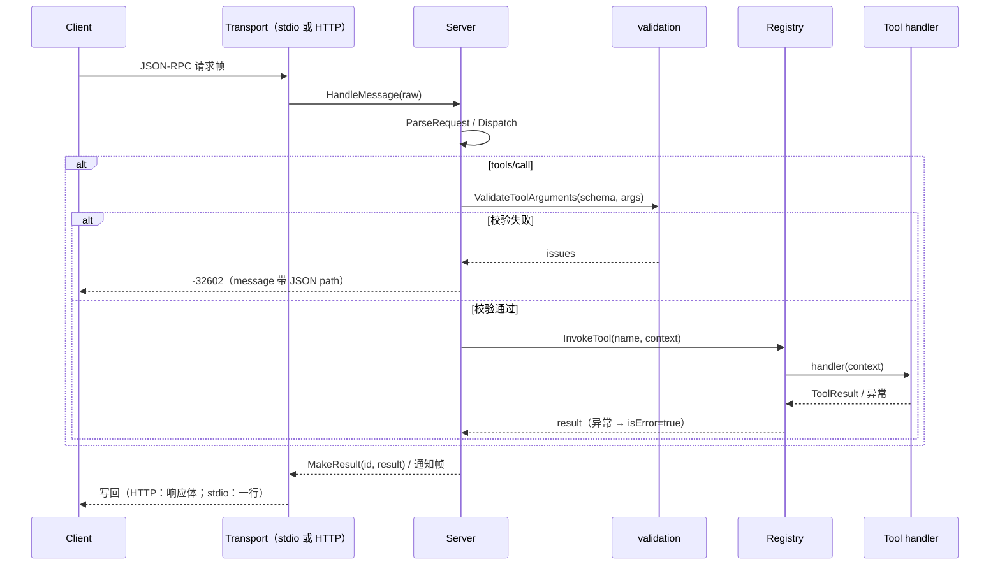
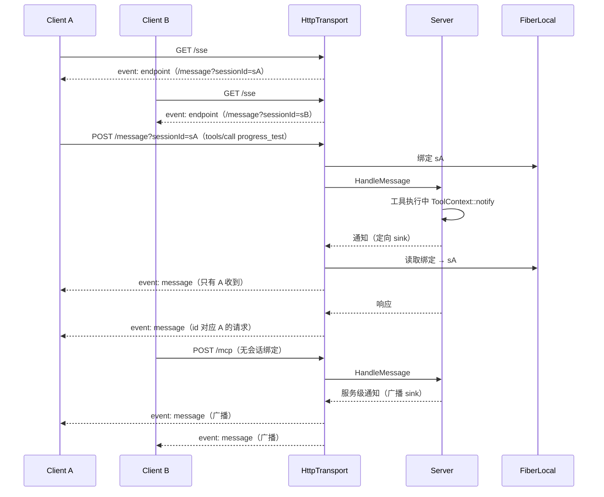
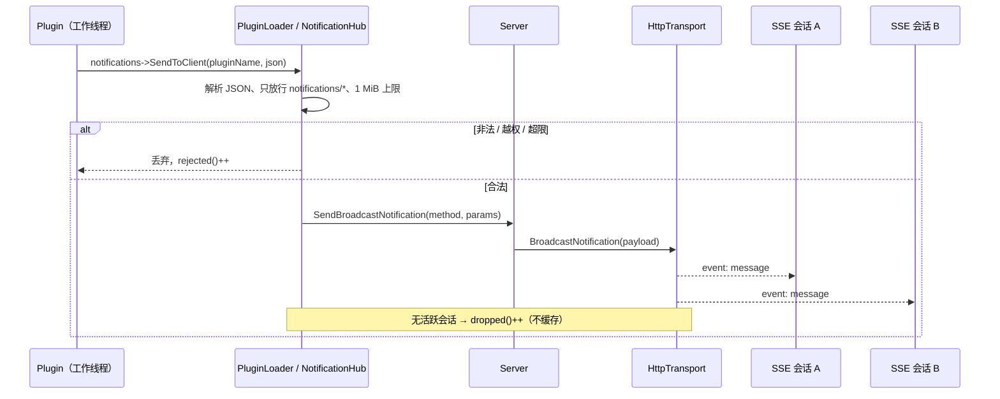
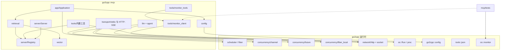

# 分层架构

> **已合并（2026-10-26）**：本文的有效内容已并入现行模块文档
> [`docs/modules/mcp.md`](../../docs/modules/mcp.md)（分层/API/设计/边界/测试，含
> `file:line` 引用）。此处保留原文与 mermaid 时序图、扩展点步骤、依赖图作为细节
> 参考；新增或修订请以 `docs/modules/mcp.md` 为准。

本文是 `Go2Cpp-mcp` 的架构基准。**每一层都有独立的目录、公开头文件与单元测试**，
新增功能先判断属于哪一层，不允许把逻辑塞回 `main.cpp` 或 `Server`。

> 构建、运行与最小配置见 [README 的快速开始](../README.md#快速开始)；
> MCP 对 go2cpp 的模块级依赖见第 13 节。

## 0. 命名空间

所有公开 API 位于 C++17 嵌套命名空间 **`go2cpp::mcp`** 下，源码统一写成
`namespace go2cpp::mcp { ... }` / `namespace go2cpp::mcp::<层> { ... }`。
`go2cpp::mcp` 是 vendored 运行时 `go2cpp::` 的子命名空间：运行时的
`go2cpp::os`、`go2cpp::concurrency` 等仍在 `go2cpp` 根下，MCP 代码用
`go2cpp::os::...` 全限定引用，**不要**把 MCP 类型放到 `go2cpp` 根命名空间，
也不要在运行时侧新增 `mcp` 同名符号。

| 目录 | 命名空间 |
| --- | --- |
| `protocol/`（`json_rpc`、`types`） | `go2cpp::mcp` |
| `server/`（`registry`、`server`） | `go2cpp::mcp` |
| `transport/`（`ITransport`、stdio、HTTP/SSE） | `go2cpp::mcp` |
| `transport/http_post` | `go2cpp::mcp::net` |
| `validation/` | `go2cpp::mcp::validation` |
| `tools/`（内置工具、`ToolBuilder`） | `go2cpp::mcp::tools` |
| `vector/`（embedding、索引） | `go2cpp::mcp::vector` |
| `retrieval/`（工具/文档检索） | `go2cpp::mcp::retrieval` |
| `llm/`（LLM 客户端） | `go2cpp::mcp::llm` |
| `llm/agent` | `go2cpp::mcp::agent` |
| `plugin/`（C ABI 加载器） | `go2cpp::mcp::plugin` |
| `config/`（`go2cpp::config` 接线） | `go2cpp::mcp::config` |
| `util/`（进程执行） | `go2cpp::mcp::util` |
| `app/`（`Builder`、`Application`） | `go2cpp::mcp::app` |
| `tests/test_util.hpp` | `go2cpp::mcp::test` |

约定：

- 头文件 **include 路径保持 `mcp/...` 不变**（`mcp` 是目录名，与命名空间无关）；
- 跨层引用写全限定 `go2cpp::mcp::...`，不依赖相对查找；不使用
  `using namespace go2cpp;`，避免把运行时符号拉进 MCP 作用域；
- 插件 `plugin_api.h` 是 `extern "C"` ABI，结构体/函数不在任何 C++ 命名空间内，
  不要给它加 `go2cpp::mcp` 限定（会改变符号名，破坏与参考项目 `.so` 的兼容）。

## 1. 六层总览

```
┌─────────────────────────────────────────────────────────────┐
│ 应用层 app/          Builder、Application、RunServer/RunAgent│
├─────────────────────────────────────────────────────────────┤
│ 检索层 retrieval/    ToolRetriever、DocumentStore            │
├─────────────────────────────────────────────────────────────┤
│ 向量层 vector/       IEmbeddingProvider、VectorIndex、Cache  │
├─────────────────────────────────────────────────────────────┤
│ 工具层 tools/        内置工具、ToolBuilder、检索类工具        │
├─────────────────────────────────────────────────────────────┤
│ 校验层 validation/   JSON Schema 子集、参数/URI 校验          │
├─────────────────────────────────────────────────────────────┤
│ 传输层 transport/    ITransport、stdio、HTTP/SSE、http_post  │
└─────────────────────────────────────────────────────────────┘
```

依赖方向（只允许向下）：

```
app ──▶ retrieval ──▶ vector
 │            │
 │            └──────▶ tools（Registry）
 ├──▶ tools ──▶ validation
 ├──▶ transport
 └──▶ protocol（领域类型，所有层可引用）
```

反向依赖禁止：`transport` 不感知工具；`vector` 不感知 MCP 协议；
`validation` 只接收 JSON，不认识 `Tool`。

## 2. 各层职责与文件映射

| 层 | 公开头文件 | 实现 | 职责 | 不负责 |
| --- | --- | --- | --- | --- |
| 传输层 | `mcp/transport/transport.hpp`、`src/transport/stdio_transport.hpp`、`src/transport/http_transport.hpp`、`mcp/net/http_post.hpp` | `src/transport/*.cpp`、`src/net/http_post.cpp` | 消息边界、字节搬运、stdio/多会话 HTTP-SSE、一次性 HTTP POST | 解析 JSON-RPC、知道工具 |
| 校验层 | `mcp/validation/schema.hpp`、`mcp/validation/validators.hpp` | `src/validation/*.cpp` | JSON Schema 子集、工具参数、资源 URI、工具定义校验 | 执行工具、IO |
| 工具层 | `mcp/tools/builtin_tools.hpp`、`mcp/tools/tool_builder.hpp`、`mcp/tools/retrieval_tools.hpp`、`mcp/tools/monitor_tools.hpp`、`mcp/server/registry.hpp` | `src/tools/*.cpp`、`src/server/registry.cpp` | 工具/提示/资源定义与注册、内置实现 | 选工具、向量化 |
| 向量层 | `mcp/vector/embedding.hpp`、`mcp/vector/vector_index.hpp` | `src/vector/*.cpp` | 文本编码、余弦相似度、top-k 索引、LRU 缓存 | 工具语义、MCP 协议 |
| 检索层 | `mcp/retrieval/tool_retriever.hpp`、`mcp/retrieval/document_store.hpp` | `src/retrieval/*.cpp` | 工具检索（RAG 选工具）、文档分块检索 | 调用 LLM、渲染协议 |
| 应用层 | `mcp/app/application.hpp` | `src/app/application.cpp`、`src/main.cpp`、`examples/agent_demo.cpp` | 装配、配置合并、启动 server / agent | 具体协议与工具细节 |

辅助层：`protocol/`（JSON-RPC 与领域类型）、`config/`（`go2cpp::config` 接线）、
`server/`（命令分发）、`plugin/`（C ABI 插件加载）、`util/`（进程执行等底层杂务）。

## 3. 关键数据流

### 3.1 tools/call

```
stdin/stdout ──▶ StdioTransport.ReadMessage
                    │
                    ▼
              Server::HandleMessage ──▶ ParseRequest（protocol）
                    │
                    ▼
              Server::Dispatch
                    │  tools/call
                    ▼
        validation::ValidateToolArguments（schema 校验，失败 -32602）
                    │
                    ▼
              Registry::InvokeTool ──▶ 工具 handler
                    │
                    ▼
        ToolResult::ToJson ──▶ 写回传输
```

### 3.2 agent 一轮

```
user prompt
   │
   ├─▶ ToolRetriever::ContextFor(prompt)   ← vector 层编码 + 索引 top-k
   │        （始终追加 search_tools / knowledge_search）
   ▼
LlmClient::Chat（DeepSeek / 任意兼容端点，net::HttpPostJson）
   │
   ├─ 无 tool_calls ──▶ 返回文本
   └─ 有 tool_calls ──▶ Registry::InvokeTool（并行 Future）
                          │
                          ▼
                    role=tool 回填 ──▶ 下一轮
```

### 3.3 检索索引（增量更新）

工具索引由**注册表事件驱动增量维护**，应用层不再在启动末尾调用 `Refresh()` 全量重建：

```text
RegisterTool / UnregisterTool（任意线程）
  │  注册表锁内完成 upsert/erase，锁外快照监听器并通知
  ▼
ToolChangeKind = kAdded | kUpdated | kRemoved
  │  ToolRetriever::OnToolChanged
  ▼
AddTool（只算 1 条向量）｜UpdateTool（文本未变复用向量，只换 schema）｜RemoveTool（erase）
  │
  ▼
VectorIndex::Add / Remove ──▶ Retrieve(query, top_k) 返回 id + 余弦分
```

文档索引按 uri 增量替换，并复用未变化块的向量：

```text
AddDirectory / AddDocument(uri, text)
  │  快照该 uri 的旧块（文本 -> 向量）；分块与向量化在锁外
  ▼
按 chunk_size 切块（换行/空白处断开，UTF-8 边界对齐）
  │  块文本命中快照 → 复用旧向量；否则 IEmbeddingProvider::Embed
  ▼
提交：删除旧块 + 插入新块（同 uri 并发写 = last-writer-wins）
```

语义与约束：

- **工具**：`kAdded` 只编码新工具一条向量；`kUpdated` 先比较「名字 + 描述」，
  文本没变（只换 handler/schema）直接复用旧向量，文本变了只重算这一条；
  `kRemoved` 直接从 `VectorIndex` erase。`Application::Create` 先构造检索器
  （此时订阅注册表事件）再注册内置工具，因此 29 个工具（22 内置 + 3 检索 + 4 监控）是逐个增量入索引的；
  启动末尾只做一次「索引条目数 == 注册表工具数」自检，不一致才回退 `Refresh()`。
- **文档**：`AddDocument` 对同一 uri 是整体替换，但按块文本复用旧向量，
  重复加载同一个文件是零向量化开销；`RemoveDocument` 删除该 uri 的全部块；
  空文本等价于清空该文档。`AddDirectory` 逐个文件调用 `AddDocument`，
  新增/修改文件天然是增量的。
- **失效/重建**：删除是容器 erase（`unordered_map`），没有墓碑，也不需要压缩；
  只有换 embedding provider/维度、或索引与注册表不一致时才需要 `Refresh()`。
  `VectorIndex::Search` 会跳过维度不一致的条目——混用 provider 不会产生错误分数，
  但会静默丢条目，因此换 provider 后必须全量重建。
- **线程安全**：注册表、检索器、向量索引各自加锁；锁顺序固定为
  `Registry::m_mutex → ToolRetriever::m_mutex → VectorIndex::m_mutex`。
  注册表事件在锁外投递（监听器快照），检索器的 embedding 也在锁外计算，
  因此「注册/注销」与「检索」可以并发，监听器回调里还可以安全地再次注册工具。
  `ToolRetriever` 析构时退订监听器，生命周期必须短于 `Registry`
  （`Application` 的成员声明顺序保证这一点）。检索期间被删除的条目可能出现在
  一次查询结果里（线性化点不同），但 `ContextFor` 会跳过已失效的工具。
- **规模上限**：`VectorIndex` 是 O(n) 暴力余弦扫描，适用于几十到几千条
  （工具 + 文档块）。实测 400 条 × 512 维、8 线程并发检索约 3.7–5.3 万 qps
  （单线程单次 P50 约 0.15ms，增量注册一条 P50 约 6µs）；上万条时应替换为
  HNSW 等近似索引，扩展点保持 `Add/Search/Remove/Get` 不变。

### 3.4 插件主动通知

```text
插件（任意线程）
  └─ PluginAPI::notifications->SendToClient(pluginName, json)
       │  C ABI：只有两个 const char*，没有 userdata
       ▼
  PluginNotificationTrampoline（宿主注入的函数指针）
       │  按 pluginName 查全局投递表（weak_ptr → Hub，卸载即删表）
       ▼
  NotificationHub::Deliver
       │  解析 JSON、只放行 notifications/*、1 MiB 上限
       ▼
  Server::SendBroadcastNotification（插件通知；补 jsonrpc、去 id）
       ├─ HTTP/SSE：广播 sink → HttpTransport::BroadcastNotification
       │            → 所有活跃 SSE 会话队列
       └─ stdio：没有广播 sink → 退回写传输（唯一客户端）
```

插件通知与工具通知走**两个出口**，不共用路由：

| 来源 | Server 入口 | HTTP/SSE 行为 |
| --- | --- | --- |
| 插件（`NotificationHub`） | `SendBroadcastNotification` | 广播给所有活跃会话 |
| 工具 / 进度（`ToolContext.notify`） | `SendNotification` | 只投递发起请求的会话（FiberLocal 绑定） |

`HttpTransport::Start` 注册定向 sink（`RouteNotification`），
`Application::RunServer` 注册广播 sink（`HttpTransport::BroadcastNotification`）；
stdio 没有 sink，统一退回直接写传输。广播 sink 在 `http` 析构前清空。

宿主在 `PluginLoader::LoadFile` 里、`Initialize()` **之前**注入
`NotificationSystem`：每个插件一份，地址由 `unique_ptr<Handle>` 保证稳定。
投递表以插件自报名字（`GetName()`）为键；插件回调时必须传同一个名字。
同名插件后加载者覆盖前者（与注册表 upsert 语义一致）。

线程与生命周期语义：

- 插件可从工作线程调用；`NotificationHub` 持锁取 sink 快照后释放，再调用
  sink，避免与 `Detach`/传输写互等；计数器是 atomic。
- `Server` 的传输指针改成 atomic，`Serve()` 退出时置空，插件线程不会拿到
  悬空指针；`HttpTransport` 析构时把 sink 间接层的 transport 置空并摘除
  sink，插件线程不会回调到已析构对象。
- 无客户端连接时**丢弃、不缓存**：`Server::notifications_dropped()` 计数。
  缓存会在服务重启后把过期通知推给新客户端，语义更差。
- 卸载顺序：`Hub::Detach()` → `Shutdown()`（此间通知计入 `dropped()`）→
  删投递表 → `DestroyPlugin()` → `dlclose()`。因此卸载后插件再调用也不会
  回调到宿主。
- 插件只能发通知：method 不以 `notifications/` 开头、非法 JSON、非对象、
  超长 payload 都计入 `rejected()` 并丢弃，插件无法借回调伪造请求/响应。

> 兼容性：`plugin_api.h` 布局与 mcp-extened 逐字段一致，本轮只填充既有
> `notifications` 字段，不新增 ABI 字段；参考项目已编译的 .so 无需重编。

### 3.5 HTTP/SSE 多会话路由

```text
GET /sse
  ├─ 写 SSE 响应头（text/event-stream）
  ├─ 分配唯一 sessionId（进程内递增 + 单调时钟，形如 s<hex>-<hex>）
  ├─ 注册 Session{queue, closed, last_active} 到 m_sessions
  └─ 推 event: endpoint / data: /message?sessionId=<id>
        │
        ├─ POST /message?sessionId=<id>（/messages 为兼容别名）
        │    ├─ 缺 id → 400（-32600）；未知/过期 id → 404（-32000）
        │    ├─ 当前 Fiber 绑定 sessionId（go2cpp::FiberLocal）
        │    ├─ Server::HandleMessage：响应 + 工具通知
        │    ├─ 响应 → 本会话 queue（SendFor，5s 背压）
        │    └─ 通知 sink → 按 FiberLocal 定向 TrySend，不串到其他会话
        │
        └─ SSE 写循环
             ├─ queue → event: message
             ├─ 每 15s 写 : ping 心跳
             ├─ 每 500ms 探测 FIN/RST → 立刻清理
             └─ 空闲超过 session_idle_timeout_ms → 清理
```

- 会话表由 `m_sessions_mutex` 保护；投递时只在锁内取 `shared_ptr`，
  发送/等待在锁外完成，避免持锁 park。
- `Server` 是共享的、本身无请求状态；会话状态只在传输层。工具通知依赖
  `FiberLocal` 绑定：同一次请求内同步发出的通知（`ToolContext::notify`）
  只进发起会话；`POST /mcp` 与插件工作线程没有绑定，走公开出口
  `BroadcastNotification(payload)`，作为服务级通知发给所有活跃会话。
  插件主动通知走 `Server::SendBroadcastNotification` → `SetBroadcastSink`
  → `BroadcastNotification`，与定向出口互不影响。
- 断开检测：SSE 循环在空闲 poll 中用 `recv(MSG_PEEK|MSG_DONTWAIT, 0ms)`
  探测 EOF/RST；收到断开或超过空闲时间都会 `CloseSession`（关闭队列并
  移除表项）。`Stop()` 关闭全部会话。
- 并发：每个连接一个 Fiber；SSE 等待 Channel、HTTP 读写都由 Go2Cpp
  park/wake 接管，不占住 worker。10 客户端 × 100 请求的隔离与吞吐见
  `test_http_e2e.py`。

## 4. 扩展点（新增功能时改哪里）

> 新增工具 / 传输 / 向量 provider 的步骤化清单见第 12 节；依赖关系见第 13 节。

| 想做的事 | 改哪里 | 不需要动 |
| --- | --- | --- |
| 加一个工具 | `src/tools/xxx.cpp` + `builtin_tools.cpp` 注册（或用 `tools::ToolBuilder`）；检索索引会随注册表事件自动增量 | server / transport / main |
| 自定义注册表订阅者 | 实现 `ToolChangeListener` 并 `Registry::AddToolListener`（锁外回调） | 检索层 / 应用层 |
| 换 embedding 模型 | 实现 `IEmbeddingProvider`，在 `Application::Create` 替换一行 | retrieval / tools |
| 换索引算法（HNSW 等） | 替换 `VectorIndex` 实现（保持 `Add/Search/Remove`） | retrieval / app |
| 加一种传输 | 实现 `ITransport`，在 `Application::RunServer` 选择 | protocol / tools |
| 加强校验规则 | `validation/schema.cpp` 增加关键字 | tools / server |
| 调整配置项 | `src/config/config.cpp` 注册 + `mcp.ini` | 其他层 |
| 放宽/收紧插件通知方法 | `src/plugin/plugin_loader.cpp` 的 `NotificationHub`（前缀白名单、1 MiB 上限） | 插件 ABI、传输层 |

## 5. 配置层

`mcp/config/config.hpp` 把可调参数接到 `go2cpp::config`：

| 完整名 | INI 写法 | 默认值 |
| --- | --- | --- |
| `mcp.llm.model` | `[mcp]` 段 `llm.model` | `deepseek-chat` |
| `mcp.llm.base_url` | `llm.base_url` | `https://api.deepseek.com/v1` |
| `mcp.llm.api_key` | `llm.api_key` | 空（回退环境变量） |
| `mcp.llm.timeout_ms` | `llm.timeout_ms` | `60000` |
| `mcp.server.name` | `server.name` | `go2cpp-mcp` |
| `mcp.server.version` | `server.version` | `0.1.0` |
| `mcp.server.workers` | `server.workers` | `1` |
| `mcp.monitor.base_url` | `monitor.base_url` | `http://127.0.0.1:9101` |
| `mcp.monitor.timeout_ms` | `monitor.timeout_ms` | `3000` |

**INI 的 section 是完整名第一个点之前的部分**（`mcp.llm.model` → `[mcp]` + `llm.model`），
这是 `go2cpp::config` 的既有规则，写配置时不要按层级拆多个 section。

优先级：命令行 > INI > 环境变量（`DEEPSEEK_API_KEY` 等）> 代码默认值。

## 6. 错误语义

| 场景 | 返回 |
| --- | --- |
| JSON 解析失败 | `-32700` |
| 缺 `name` / 参数类型不符 / schema 约束不满足 / URI 非法 | `-32602`，`message` 带 JSON 路径 |
| 未知方法 | `-32601` |
| 未知工具 | `-32001` |
| 工具内部业务失败（除零、负数开方等） | `result.isError=true`（协议成功） |
| 未知资源 | `-32000` |
| HTTP `POST /message` 缺 `sessionId` | 400 + JSON-RPC `-32600` |
| HTTP `POST /message` 未知/过期 `sessionId` | 404 + JSON-RPC `-32000` |
| HTTP 会话在请求处理期间断开 | 404（响应无处投递，客户端应重新建连） |

校验层把「schema 约束」提前到协议层，因此 `factorial n=21`、`search_tools` 缺
`query`、多余字段等都会得到 `-32602`，而不是进入工具内部再报业务错误。这与
MCP 的 `inputSchema` 语义一致，也是相对旧实现的行为变化。

## 7. 测试地图

| 层 | 测试 |
| --- | --- |
| 传输 | `test_stdio_e2e.py`、`test_http_e2e.py`（多会话隔离 / 通知定向 / 断开重连 / 10x100 压测 / 空闲超时） |
| 校验 | `test_validation.cpp`、`test_layers_e2e.py`（-32602 断言） |
| 工具 | `test_tools.cpp`、`test_registry.cpp`、`test_plugin_e2e.py` |
| 监控工具 | `test_monitor_tools.cpp`（注册/schema/Manager 未启动/真实 Manager/404/停止）、`test_monitor_e2e.py`（真实 Manager + 真实 stdio server 全链路） |
| 向量 | `test_vector.cpp` |
| 检索 | `test_retrieval.cpp`（增量注册/覆盖/注销、增量 vs 全量一致、随机顺序 200 步属性测试、并发注册与检索 100 次/线程、文档块复用与删除、应用层自动增量、压测）、`test_layers_e2e.py`（search_tools / knowledge_search） |
| 应用 | `test_agent_offline.py`、`test_layers_e2e.py`（配置覆盖） |
| 配置 | `test_layers_e2e.py`（`--config` 覆盖服务名） |
| 插件通知 | `test_plugin_notify.cpp`（注入/拒绝/无客户端/卸载/并发）、`plugin_notify_e2e.py`（stdio + HTTP/SSE 广播） |

## 8. 多会话 SSE 的边界

- 会话是单进程内存态：多实例部署需要粘滞路由或共享会话总线；进程重启后
  旧 `sessionId` 全部失效。
- 不支持 `Last-Event-ID` 断点续传；SSE 断开即销毁会话，客户端须重新
  `GET /sse` 并换用新 `sessionId`。
- 两个出口：`HttpTransport::BroadcastNotification(payload)` 广播给所有
  活跃 SSE 会话（插件主动通知走 `Server::SendBroadcastNotification` /
  `SetBroadcastSink`；`POST /mcp` 的无绑定定向通知也回退到这里）；请求级
  通知（`/message` 内的工具通知）经 `FiberLocal` 严格定向，广播全收、
  定向不串。
- 响应队列满时 `POST /message` 最多等 5s 背压，随后返回 404；通知队列满
  时直接丢弃，避免阻塞插件线程。
- 会话空闲超时只统计「收到 POST / 成功推送事件」；纯监听且长期无事件的
  会话会在默认 300s 后关闭。
- 调参环境变量：`MCP_SSE_HEARTBEAT_MS`、`MCP_SSE_POLL_MS`、
  `MCP_SSE_IDLE_TIMEOUT_MS`（<=0 关闭空闲超时）。这三个是传输层测试/部署
  钩子，不经过 `config/` 层。

## 9. 监控工具（`os_monitor_*`）

工具层不直接拼 URL、不 include 网络头文件；四个 handler 只依赖
`tools::MonitorClient` 接口，HTTP/JSON 细节在客户端实现里：

```text
Application::Create
  └─ RegisterMonitorTools(registry, MakeHttpMonitorClient(MonitorOptions))
       ├─ 生产：HttpMonitorClient（地址规范化、HTTP 状态/JSON 解析、错误分类）
       └─ 测试：MockMonitorClient（可编程数据、错误注入、调用记录，零网络）
```

| 工具 | `MonitorClient` 方法 | Manager 接口 | 返回 |
| --- | --- | --- | --- |
| `os_monitor_latest` | `Latest(MonitorQuery)` | `GET /api/query/latest?n=<limit>` | 最近快照数组（CPU/内存/磁盘/网络/内核累计值） |
| `os_monitor_stats` | `Stats(MonitorQuery)` | `GET /api/query/stats` | 每主机汇总 + 健康评分（0-100，降序） |
| `os_monitor_kernel` | `Kernel(MonitorQuery)` | `GET /api/query/kernel` | syscall/sched/futex/tcp/fileio 摘要（top-N + 分位数） |
| `os_monitor_health` | `Health(MonitorQuery)` | `GET /api/health` | Manager 状态与 received/rejected/stored |

`MonitorQuery` 统一承载参数：`limit`（1–256，默认 10）、`timeout_ms`
（100–60000，默认取 `mcp.monitor.timeout_ms`）、`base_url`（对应工具参数
`manager_url`，空表示用客户端配置）。`os_monitor_health` 的 schema 不接受
`limit`（`additionalProperties:false`，传了在协议层得到 `-32602`）。

错误语义：客户端把失败收敛成 `MonitorError{kind, message, http_status}`，
kind 取 `kInvalidEndpoint / kConnect / kTimeout / kParse / kHttpStatus /
kResponseFormat`；工具把 `message` 原样放进 `result.isError=true` 的文本
（附 URL 与排查提示），**不是** JSON-RPC 错误，也不会让 server 退出。
协议层 schema 违规（非法 scheme、越界数值、未知字段）仍然返回 `-32602`。

由应用层在装配阶段注册、而不是放进 `RegisterBuiltinTools`：本组工具依赖
「Manager 监听在哪」这一部署配置，注册只捕获客户端、不发请求。因此 Manager
未启动时 MCP 服务照常提供其它工具，只有调用监控工具才得到连接错误。
`RegisterMonitorTools(registry, nullptr)` 也会注册四个工具，但调用返回
「MonitorClient 未配置」的配置错误——便于测试与可选装配。

## 10. 各层 API 参考

本节按「调用者需要知道什么」列公开接口；签名取自 `mcp/include/mcp/**` 与
`mcp/src/**` 的实际声明。所有类型都在 `go2cpp::mcp` 子命名空间下。

### 10.1 协议层（`protocol/`）

```cpp
enum class RpcError : int {
    kParseError = -32700, kInvalidRequest = -32600, kMethodNotFound = -32601,
    kInvalidParams = -32602, kInternalError = -32603,
    kServerError = -32000, kToolNotFound = -32001,
};

struct Request {
    json id = nullptr;              // 通知为 null
    std::string method;             // "tools/call" 等
    json params = json::object();
    bool notification = false;      // 原始帧没有 id 键
    bool ExpectsResponse() const noexcept;
};

struct ParseOutcome { bool ok; Request request; json error; };
ParseOutcome ParseRequest(const json& document);
json MakeResult(const json& id, json result);
json MakeError(const json& id, RpcError code, std::string message, json data = nullptr);
json MakeNotification(std::string method, json params = json::object());
```

领域类型（`types.hpp`）：`Content{type,text}`、`ToolResult{is_error,content,structured}`
（`ToolResult::Text(text, is_error=false)`）、`ToolContext{arguments,meta,notify,
progress_token()}`、`Tool{name,description,input_schema,handler}`、
`Prompt{name,description,arguments,handler}`、`Resource{uri,name,description,
mime_type,reader}`。所有 `ToJson()` 负责字段名与 MCP 规范一致。

### 10.2 传输层（`transport/`、`net/`）

```cpp
class ITransport {
 public:
    virtual bool Start() = 0;
    virtual void Stop() = 0;
    virtual std::optional<std::string> ReadMessage() = 0;   // EOF/停止 → nullopt
    virtual bool WriteMessage(std::string_view message) = 0; // 实现补分隔符
    virtual std::string Name() const = 0;
};
```

`StdioTransport`（`src/transport/stdio_transport.hpp`）：从 stdin 按行读、向 stdout
写一行；`WriteMessage` 内部加锁。`HttpTransport`（`src/transport/http_transport.hpp`）：

```cpp
struct Options {
    std::string host = "127.0.0.1";
    std::uint16_t port = 8765;              // 0 = 内核分配
    int workers = 4;                        // 连接级 Fiber 数
    int heartbeat_interval_ms = 15000;
    int poll_interval_ms = 500;
    int session_idle_timeout_ms = 300000;    // <=0 关闭
    std::size_t session_queue_capacity = 1024;
};

HttpTransport(Server& server, Options options);
bool Start(std::uint16_t& actual_port, std::string& error);
void Run();                                   // 阻塞 accept 循环
void Stop();
void BroadcastNotification(const std::string& payload);
```

`net/http_post.hpp`：

```cpp
struct HttpPostOptions {
    std::string api_key;                            // 非空时加 Bearer
    std::chrono::milliseconds timeout{60000};
    std::string content_type = "application/json";
};
bool HttpPostJson(const std::string& url, const std::string& body,
                  const HttpPostOptions& options, std::string& response_body,
                  std::string& error);
```

`http://` 走 Go2Cpp `http::Client`，`https://` 委托系统 `curl` 子进程。

### 10.3 校验层（`validation/`）

```cpp
struct Issue { std::string path; std::string message; };
struct Result { bool ok = true; std::vector<Issue> issues; std::string Summary() const; };

Result Validate(const json& schema, const json& value,
                const std::string& root_path = "$");
Result ValidateToolArguments(const json& input_schema, const json& arguments);
Result ValidateToolDefinition(const json& input_schema);
Result ValidateResourceUri(const std::string& uri);
```

支持的关键字见 `schema.hpp` 文件头：`type/enum/const/required/properties/
additionalProperties/items/minimum/maximum/minLength/maxLength/pattern/
minItems/maxItems/anyOf/oneOf`。`$ref/allOf/format` 等**被忽略而非报错**。

### 10.4 工具层（`tools/`、`server/registry.hpp`）

```cpp
class ToolBuilder {  // 链式；名字重复按注册表语义覆盖
    ToolBuilder& AddTool(std::string name, std::string description, json schema,
                         std::function<ToolResult(const ToolContext&)> handler);
    ToolBuilder& AddPrompt(std::string name, std::string description,
                           std::vector<PromptArgument> arguments,
                           std::function<json(const json&)> handler);
    ToolBuilder& AddResource(std::string uri, std::string name, std::string description,
                             std::string mime_type, std::function<json(const json&)> reader);
};

void RegisterBuiltinTools(Registry&);                    // 22 个
void RegisterRetrievalTools(Registry&, retrieval::ToolRetriever&,
                            retrieval::DocumentStore&);  // 3 个
void RegisterMonitorTools(Registry&, std::shared_ptr<MonitorClient>);  // 4 个
void RegisterMonitorTools(Registry&, MonitorOptions);                  // 便利重载
```

注册表：

```cpp
enum class ToolChangeKind { kAdded, kUpdated, kRemoved };
using ToolChangeListener = std::function<void(ToolChangeKind, const Tool&)>;

void RegisterTool(Tool);
bool UnregisterTool(const std::string& name);
std::size_t AddToolListener(ToolChangeListener);   // 返回 id，锁外回调
bool RemoveToolListener(std::size_t id);
std::optional<json> ToolSchema(const std::string& name) const;
std::optional<ToolResult> InvokeTool(const std::string& name, const ToolContext&) const;
json ToolList/PromptList/ResourceList() const;
std::size_t tool_count/prompt_count/resource_count() const;
```

### 10.5 向量层（`vector/`）

```cpp
using Embedding = std::vector<float>;

class IEmbeddingProvider {
    virtual std::string Name() const = 0;
    virtual std::size_t Dimension() const = 0;
    virtual bool Embed(std::string_view text, Embedding& out, std::string& error) = 0;
    virtual bool EmbedBatch(const std::vector<std::string>&, std::vector<Embedding>&,
                            std::string& error);   // 默认逐个调用
};

HashEmbeddingProvider(std::size_t dimension = 512);   // FNV-1a n-gram，离线
HttpEmbeddingProvider(HttpEmbeddingProvider::Options); // OpenAI 兼容 /embeddings

class EmbeddingCache {  // 线程安全 LRU
    EmbeddingCache(std::size_t capacity = 256);
    bool Get(const std::string& key, Embedding& out);
    void Put(const std::string& key, Embedding value);
    Stats Snapshot() const;   // hits / misses / entries
};

class VectorIndex {  // 暴力余弦，shared_mutex
    void Add(const std::string& id, Embedding);
    bool Remove(const std::string& id);
    bool Contains(const std::string& id) const;
    bool Get(const std::string& id, Embedding& out) const;
    std::vector<SearchHit> Search(const Embedding&, std::size_t top_k,
                                  float min_score = -1.0f) const;
    bool Save/Load(const std::string& path, std::string* error = nullptr) const;
};
```

`Search` 跳过维度不一致的条目；`Save` 的文本格式是 `MCPVEC1 <count>` + 每行
`<id>\t<v1>,<v2>,...`。

### 10.6 检索层（`retrieval/`）

```cpp
struct RetrieveOptions { std::size_t top_k = 5; float min_score = 0.05f; };
struct RetrievedItem { std::string id; float score; };
struct ToolRetrieverStats { indexed, embedded, reused, removed, rebuilds, failures };

ToolRetriever(Registry&, vector::IEmbeddingProvider&,
              RetrieveOptions = {}, bool subscribe = true);
std::vector<RetrievedItem> Retrieve(const std::string& query);
std::vector<RetrievedItem> Retrieve(const std::string& query, std::size_t top_k);
json ContextFor(const std::string& query);        // OpenAI tools 形态的 top-k
bool AddTool/UpdateTool/RemoveTool/Refresh();
std::size_t IndexedTools() const;
ToolRetrieverStats Stats() const;
bool subscribed() const;
std::string LastError() const;

struct ChunkOptions { std::size_t chunk_size = 400; std::size_t overlap = 80; };
DocumentStore(vector::IEmbeddingProvider&, ChunkOptions = {});
bool AddDocument(const std::string& uri, const std::string& text, std::string& error);
bool RemoveDocument(const std::string& uri);
std::size_t AddDirectory(const std::string& directory, std::string& error);
std::vector<vector::SearchHit> Search(const std::string&, std::size_t top_k,
                                      float min_score = 0.05f);
std::optional<DocumentChunk> Get(const std::string& id) const;
Stats Snapshot() const;   // documents / chunks / embedded / reused
```

`ToolRetriever` 构造时订阅注册表（`subscribe=true`），析构自动退订；锁顺序
`Registry::m_mutex → ToolRetriever::m_mutex → VectorIndex::m_mutex`。

### 10.7 服务端与应用层（`server/`、`app/`）

```cpp
struct ServerOptions {
    std::string name = "go2cpp-mcp";
    std::string version = "0.1.0";
    std::string protocol_version = "2025-06-18";
    bool verbose = false;
    int workers = 1;
};

Server(ServerOptions, Registry&);       // Registry 不转移所有权
int Serve(ITransport& transport);
void Stop();
void ProcessMessage(const std::string& raw);
std::optional<std::string> HandleMessage(const std::string& raw);  // 无 IO，可单测
void SendNotification(const std::string& method, json params);          // 定向
void SendBroadcastNotification(const std::string& method, json params); // 广播
void SetNotificationSink(std::function<void(const std::string&)>);
void SetBroadcastSink(std::function<void(const std::string&)>);
std::size_t notifications_dropped() const noexcept;
```

```cpp
struct AppOptions {
    config::ServerSettings server;
    config::LlmSettings llm;
    config::MonitorSettings monitor;
    std::string config_file;
    std::string plugins_dir;
    std::string resources_dir;
    int http_port = 0;              // >0 走 HTTP/SSE，否则 stdio
    bool verbose = false;
    bool retrieval = true;
    std::size_t embedding_dimension = 512;
    std::size_t retrieval_top_k = 5;
};

static std::unique_ptr<Application> Application::Create(AppOptions, std::string* error);
int RunServer();                    // 阻塞；stdio 或 HTTP
int RunAgent(prompt, max_iterations, verbose, std::string* output);
void RegisterTool(Tool);            // 运行期注册，索引由监听器增量维护
bool UnregisterTool(const std::string& name);
Registry& registry(); retrieval::ToolRetriever* retriever();
retrieval::DocumentStore* documents();

Builder& WithConfigFile/WithModel/WithBaseUrl/WithApiKey/WithServerName/
         WithServerVersion/WithWorkers/WithHttpPort/WithPlugins/WithResources/
         WithVerbose/WithRetrieval/WithEmbeddingDimension/WithRetrievalTopK(...);
std::unique_ptr<Application> Build(std::string* error = nullptr);
```

### 10.8 LLM、配置与插件

```cpp
struct LlmConfig { std::string base_url, api_key, model; int timeout_ms = 60000; };
struct ToolCall { std::string id, name; json arguments; };
struct ChatResponse { bool ok; std::string error, content;
                      std::vector<ToolCall> tool_calls; json message; };
ChatResponse LlmClient::Chat(const json& messages, const json& tools) const;
static bool LlmClient::HttpPost(...);   // https→curl，http→Go2Cpp

struct AgentConfig { std::string system_prompt; int max_iterations = 8;
                     bool parallel_tool_calls = true; };
Agent(llm::LlmClient, Registry&, AgentConfig = {});
std::string Run(const std::string& user_prompt, std::vector<AgentStep>* trace = nullptr);
void SetToolRetriever(retrieval::ToolRetriever*);

// config/config.hpp
LlmSettings LoadLlmSettings(); ServerSettings LoadServerSettings();
MonitorSettings LoadMonitorSettings(); std::string ApiKeyFromEnv();
bool LoadConfigFile(const std::string& path, std::string* error = nullptr);
std::string ResolveConfigFile();

// plugin/plugin_loader.hpp（C ABI 见 plugin_api.h）
class NotificationHub { void Deliver(...); forwarded()/dropped()/rejected(); };
class PluginLoader { bool LoadDirectory(const std::string& dir, Registry& registry,
                                        std::string& error); };
```

### 10.9 监控客户端（`tools/monitor_client.hpp`）

```cpp
enum class MonitorErrorKind : std::uint8_t {
    kNone, kInvalidEndpoint, kConnect, kTimeout, kParse, kHttpStatus, kResponseFormat,
};
struct MonitorError { MonitorErrorKind kind; std::string message; int http_status; };
template <typename T> struct Result { bool ok; T value; MonitorError error;
    static Result Ok(T); static Result Fail(MonitorErrorKind, std::string, int = 0); };
struct MonitorQuery { int limit = 10; int timeout_ms = 3000; std::string base_url; };
struct MonitorOptions { std::string base_url = "http://127.0.0.1:9101";
                        int timeout_ms = 3000; };

class MonitorClient {
    virtual Result<json> Latest(const MonitorQuery&) = 0;
    virtual Result<json> Stats(const MonitorQuery&) = 0;
    virtual Result<json> Kernel(const MonitorQuery&) = 0;
    virtual Result<json> Health(const MonitorQuery&) = 0;
    virtual std::string BaseUrl() const;          // 展示用
    virtual MonitorQuery DefaultQuery() const;    // 未传参时的默认查询
};

class HttpMonitorClient final : public MonitorClient { /* 生产实现，只用 http:// */ };
std::shared_ptr<MonitorClient> MakeHttpMonitorClient(MonitorOptions = {});

class MockMonitorClient final : public MonitorClient {
    // SetLatest/SetStats/SetKernel/SetHealth、SetFailure、calls()
    // 测试注入：零网络、可编程数据与错误
};
```

`HttpMonitorClient` 只接受 `http://`，负责地址规范化、HTTP 状态与 JSON 解析，
并把失败映射为 `MonitorErrorKind`；工具层只消费 `MonitorError.message`。

## 11. 时序图

### 11.1 stdio / HTTP `tools/call`



`HTTP POST /mcp` 与 stdio 共用 `HandleMessage`；区别只在响应如何写回
（HTTP 一请求一响应，stdio 写 stdout）。

### 11.2 SSE 多会话



断开检测：SSE 循环每 `poll_interval_ms`（默认 500ms）用
`recv(MSG_PEEK|MSG_DONTWAIT, 0ms)` 探测 FIN/RST；每 `heartbeat_interval_ms`
（默认 15s）写 `: ping`；空闲超过 `session_idle_timeout_ms`（默认 300s）清理。

### 11.3 插件通知广播



stdio 没有广播 sink，`SendBroadcastNotification` 退回写传输（唯一客户端）。

## 12. 扩展点（步骤化）

### 12.1 新增一个 MCP 工具

1. 在 `mcp/src/tools/` 新建或复用编译单元，用 `ToolBuilder::AddTool` 定义
   `name / description / inputSchema / handler`；
2. 在 `builtin_tools.cpp` 的 `RegisterBuiltinTools` 里调用（或在
   `Application::Create` 里单独注册，若依赖部署配置——参考 `monitor_tools.cpp`）；
3. 参数 schema 已由校验层自动生效，无需在 handler 里重复检查类型；
4. 若工具需要被 `search_tools` 命中，确保描述里包含使用者会说的关键词；
   注册表事件会自动增量入索引；
5. 在 `mcp/tests/test_tools.cpp` 或新建测试里加断言，并跑 `ctest -R tools`。
   不需要改 `server/`、`transport/`、`main.cpp`。

### 12.2 新增一种传输

1. 实现 `ITransport` 的 5 个纯虚函数（`Start/Stop/ReadMessage/WriteMessage/Name`）；
2. 在 `Application::RunServer` 里按 `AppOptions` 选择新实现；
3. 若传输需要把通知投递到特定客户端，设置 `Server::SetNotificationSink`
   （定向）与 `SetBroadcastSink`（广播）；不要在工具层写传输逻辑；
4. 加 `test_*_e2e.py` 覆盖握手、错误码与断开路径。协议层与工具层零改动。

### 12.3 新增向量 provider

1. 实现 `vector::IEmbeddingProvider` 的 `Name/Dimension/Embed`（可选
   `EmbedBatch`）；
2. 在 `Application::Create` 里把 `HashEmbeddingProvider` 替换为你的实现
   （或新增 `--embedding-provider` 配置）；
3. 换 provider/维度后必须让 `ToolRetriever::Refresh()` 全量重建，
   `DocumentStore` 重新 `AddDirectory`；否则旧向量会被 `VectorIndex::Search`
   按维度跳过；
4. 用 `test_vector.cpp` / `test_retrieval.cpp` 验证余弦分数与增量语义。

### 12.4 新增监控采集器

1. 在 `go2cpp/include/go2cpp/os/monitor/monitor.hpp` 增加字段与 `Status` 语义；
2. 实现 `Monitor` 子类（`UpdateOnce/Stop/available/reason`），在
   `aggregator.cpp` 的 `Impl` 中创建并加入 `CollectorKind`；
3. 在 `AggregatorConfig` 增加 `enable_xxx` 开关，并在 `Start()` 的采集
   Fiber 列表里注册；
4. `to_json/from_json` 与 Manager 的 `KernelSummaries/Latest` 透传字段；
5. 加非 root 降级契约测试 + root 真实数据测试（参考 `test_kernel_monitor.cpp`）。

### 12.5 替换监控数据源（`MonitorClient`）

1. 实现 `tools::MonitorClient` 的 `Latest/Stats/Kernel/Health`（`MonitorQuery`
   入参、`Result<json>` 返回；失败填 `MonitorError`，不要抛异常）；
2. 在 `Application::Create` 里把 `MakeHttpMonitorClient(options)` 换成你的工厂；
3. 工具层（`monitor_tools.cpp`）与 schema、错误文本、`limit/timeout` 语义
   不需要改；单测可直接注入 `MockMonitorClient`；
4. 若实现不是 HTTP，确认不再需要 `mcp.monitor.base_url`，但保留配置键可让
   部署方选择具体端点。

## 13. 依赖图：mcp → go2cpp

MCP 生产代码（`mcp/include`、`mcp/src`、`mcp/examples`）只通过 **9 个运行时
头文件**取用能力（`grep -rhoE 'go2cpp/[A-Za-z0-9_/]+[.]hpp' mcp/include mcp/src mcp/examples | sort -u | wc -l`
实测）；测试代码另外直接包含 2 个监控头文件（`os/monitor/monitor.hpp`、
`os/monitor/manager.hpp`），合计 11 个。监控工具的 HTTP 依赖下沉在
`tools/monitor_client.cpp`，`monitor_tools.cpp` 本身不含网络头文件。



| 运行时模块 | MCP 使用点 | 头文件 |
| --- | --- | --- |
| `scheduler` / `fiber` | `workers>1` 时每请求一个 G；agent 并行 tool_calls 用 `go()` | `go2cpp/scheduler/scheduler.hpp`、`go2cpp/tools/go.hpp` |
| `channel` | SSE 会话推送队列、Aggregator 结果汇聚 | `go2cpp/concurrency/channel.hpp` |
| `future` | agent 一轮多个 tool_calls 的 `Promise/Future` | `go2cpp/concurrency/future.hpp` |
| `fiber_local` | `/message` 请求与 SSE 会话的绑定 | `go2cpp/concurrency/fiber_local.hpp` |
| `network/http` | 一次性 POST、HTTP 服务端、Manager 查询 | `go2cpp/network/http.hpp` |
| `network/socket` | HTTP/SSE 监听与连接 | `go2cpp/network/socket.hpp` |
| `os` | 工具执行子进程（ROS 2、curl） | `go2cpp/os/proc.hpp` |
| `config` | 全部 `mcp.*` 配置项 | `go2cpp/config/config.hpp` |
| `os::monitor` | **仅测试**：`test_monitor_tools`、`monitor_e2e` 使用 Manager/Snapshot 类型；生产工具层只依赖 `MonitorClient` | `go2cpp/os/monitor/monitor.hpp`、`manager.hpp`（经 `go2cpp_os_monitor`） |

链接关系：`mcp_core PUBLIC go2cpp_runtime`；`go2cpp_runtime` 是 INTERFACE 目标，
聚合 21 个模块（error/control_flow/context/channel/scheduler/fiber/sync/future/
io/network/log/config/os/math/rand/path/container/compress/encoding/hash/metrics）
+ `go2cpp_os_monitor`（`Go2CppMonitor.cmake` 追加）+ `Threads::Threads`。顶层构建
关闭了 `go2cpp_hook`，因此没有 LD_PRELOAD interposer。

依赖方向的硬约束：MCP 不修改 `go2cpp/`（除监控模块已有实现），也不把 MCP 类型
放进 `go2cpp` 根命名空间；运行时侧不感知 MCP 协议。

## 14. 限制与边界

架构层面的硬限制（部署与使用中的完整列表见
[README 的「限制与已知问题」](../README.md#限制与已知问题)）：

- **无 TLS**：HTTP/SSE 是明文；HTTPS LLM 端点由 `curl` 子进程完成，不是纯 C++ 链路。
- **监控只支持 HTTP**：`MonitorClient` 的 `base_url` 只接受 `http://`，Manager 无认证；
  部署在不可信网络时需在前面加反向代理。
- **协议版本固定**：`initialize` 只回 `2025-06-18`，无版本协商矩阵；不支持流式响应。
- **会话是单进程内存态**：多实例需要粘滞路由；SSE 不支持 `Last-Event-ID` 续传。
- **eBPF 需要 root**：非 root 时 6 个 eBPF 采集器降级，`/proc` 的 4 个继续工作。
- **Manager 默认不持久化**：内存环形缓冲 256 条，重启即清空；可注入 `SnapshotStore`。
- **插件同进程**：`dlopen` 加载，无隔离，插件崩溃会带崩服务。
- **平台**：只在 Linux x86_64 / WSL2 验证；Windows / macOS 未验证。
- **构建开关**：顶层关闭 `go2cpp_hook` 与运行时自带测试；eBPF 依赖
  clang/libbpf/libelf/libz，缺失时 configure 期静默关闭。
